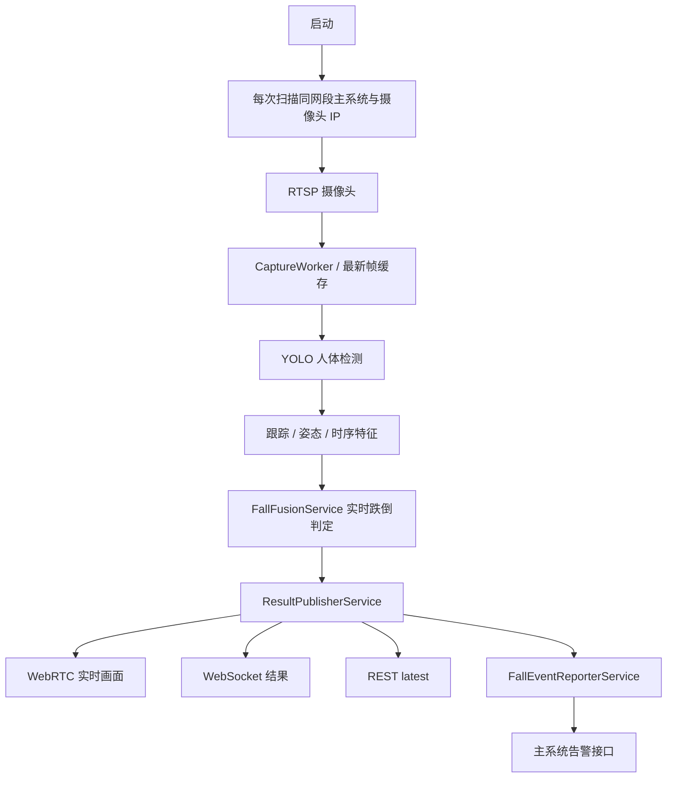
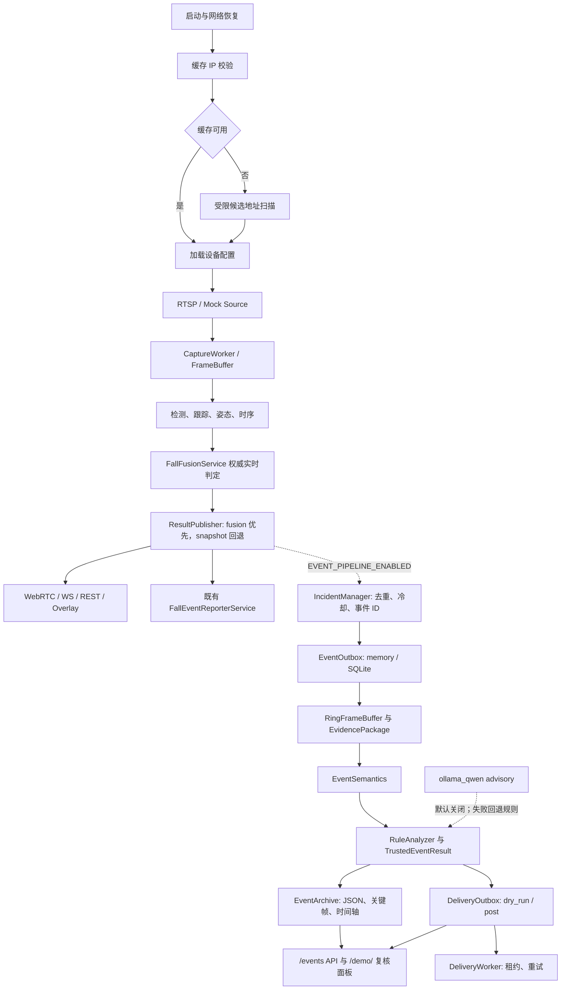
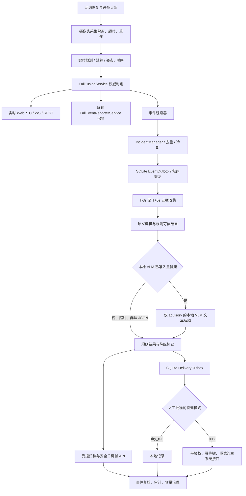

# 事件级语义增强链路当前状态与交接

日期：2026-07-18  
适用对象：项目负责人、后端工程师、前端工程师、智能体工程师、答辩汇报人员  
范围：`camera-service` 的跌倒检测实时主链路及事件级语义旁路增强

## 1. 当前总状态

当前系统已经具备事件级语义旁路的代码能力、接口、归档治理、DeliveryOutbox
和前端复核面板。它们均由功能开关控制，默认关闭。实时主链路仍由
`FallFusionService` 的融合结果承担权威跌倒判定；WebRTC、WebSocket、REST
实时结果和既有 `FallEventReporterService` 不依赖事件旁路。

当前结论：**适合本地演示、回放、synthetic、SQLite dry-run 和 loopback mock
验证；不具备正式生产启用条件。**

关键边界：

- 事件语义链路是旁路增强，不改变 `FallFusionService` 的 `fallen_confirmed`
  判定，也不阻塞实时采集、检测、融合、WebRTC、WS 或 REST。
- `DeliveryOutbox` 是可选的新投递通道，不替代、不删除
  `FallEventReporterService`。
- 本地 Ollama 千问只产生 advisory 文本字段，不能改写 `fall_state`、
  `final_event_type`、`final_risk_level` 或告警支持结论。
- 图片输入、关键帧、图片路径、关键帧 URL、绝对路径、`incident_id` 和
  `track_id` 均不发送给本地 Ollama smoke；图片输入默认关闭。
- 真实主系统 POST 从未启用，必须经人工批准、接收方联调和单摄像头灰度后才可
  尝试。

## 2. 链路演进

### 2.1 修改前链路



原有链路以逐帧实时输出为中心，没有事件 ID、证据包、语义复核、归档治理或
可恢复的投递 Outbox。

### 2.2 当前实现链路



实线部分是实时权威链路。虚线旁路只有显式开启事件开关后才会运行。
`FallEventReporterService` 仍保留在原位置。

### 2.3 完全优化目标链路



目标图中真实主系统投递、真实摄像头稳定性、VLM 准入、鉴权、并发治理和运维
责任制尚未完成，不能视为当前能力。

## 3. 已完成能力清单

| 能力 | 当前状态 | 说明 |
| --- | --- | --- |
| 网络恢复 | 已实现 | 优先使用缓存 IP，失败后在受限范围发现主系统和摄像头。 |
| 实时结果安全 | 已实现 | 融合优先、快照回退；主链路与事件旁路解耦。 |
| 事件生命周期 | 已实现，默认关闭 | `fallen_candidate` / `fallen_confirmed` 观察、事件 ID、去重、冷却、Outbox。 |
| 证据包 | 已实现，默认关闭 | 六个时间槽：T-3、T-1、T0、T+1、T+3、T+5；缺帧保留真实原因。 |
| 后事件补帧 | 已实现，默认关闭 | 二阶段定时收集，状态可为 `collecting`、`complete`、`degraded`。 |
| 语义与可信结果 | 已实现，默认关闭 | 结构化 `EventSemantics`、规则优先 `TrustedEventResult`。 |
| 归档与关键帧 API | 已实现，默认关闭 | 目录包含、路径脱敏、非法 ID 与穿越拒绝、容量清理。 |
| 前端复核 | 已实现 | `/demo/` 可展示事件、语义、时间轴和投递状态；真实运行截图仅来自 P1 replay。 |
| DeliveryOutbox | 已实现，默认关闭 | memory/SQLite、幂等、CAS 租约、重试、dry-run、读 API。 |
| Delivery 鉴权头 | 已实现，默认关闭 | 仅在 `MAIN_SYSTEM_ALERT_TOKEN_HEADER` 和 `MAIN_SYSTEM_ALERT_TOKEN` 都非空时发送。 |
| 生产前检查 | 已实现 | 只读脚本检查配置/源码边界，不改文件、不联网、不启动 worker。 |
| 本地 Ollama provider | 已实现，默认关闭 | 仅 loopback、`stream=false`、`format=json`、结构化文本 advisory；真实 smoke 为 REVISE。 |

## 4. 默认关闭配置

以下为 `.env.example` 的安全默认态。实际 `.env` 未因 P1-P14 验收而被修改。

```dotenv
MAIN_SYSTEM_ALERT_ENABLED=false

EVENT_PIPELINE_ENABLED=false
EVENT_RING_BUFFER_ENABLED=false
EVENT_WORKER_ENABLED=false
EVENT_SEMANTIC_ENABLED=false
EVENT_POST_KEYFRAME_COLLECTION_ENABLED=false
EVENT_ARCHIVE_ENABLED=false
EVENT_KEYFRAME_SERVING_ENABLED=false

EVENT_DELIVERY_ENABLED=false
EVENT_DELIVERY_MODE=dry_run
EVENT_DELIVERY_BACKEND=memory
EVENT_DELIVERY_WORKER_ENABLED=false
EVENT_DELIVERY_TARGET_URL=
EVENT_DELIVERY_ENDPOINT=

EVENT_VLM_ENABLED=false
EVENT_VLM_PROVIDER=dummy
EVENT_VLM_OLLAMA_ENDPOINT=http://127.0.0.1:11434/api/chat
EVENT_VLM_OLLAMA_TEXT_ONLY=true
EVENT_VLM_OLLAMA_INCLUDE_IMAGES=false
```

仅将 `EVENT_PIPELINE_ENABLED=true` 不会自动打开 Delivery、VLM、关键帧图片
服务或主系统告警。

## 5. P1-P13-smoke 验收结果

| 阶段 | 结果 | 已证明内容 | 未证明/限制 |
| --- | --- | --- | --- |
| P1 事件旁路 replay | PASS（candidate） | replay 下 REST、WS、WebRTC、归档、事件 API、前端复核可用。 | 仅 `fallen_candidate`；后事件三帧曾缺失。 |
| P2 归档安全治理 | PASS | 非法事件 ID、路径穿越、关闭图片服务、路径脱敏、归档保留治理均有测试。 | 仍是配置门控，不是面向公网的用户级鉴权。 |
| P3 SQLite dry-run | PASS | DeliveryRecord、幂等、重启恢复、四个 delivery API；`requests.post` 为零。 | 未请求真实主系统。 |
| P4 mock post | PASS | loopback 200、500、超时、非法响应及重试/租约状态流转。 | 仅 mock server。 |
| P5 生产投递预案 | PASS（文档/审查） | 合同、灰度、回滚和前置检查已整理。 | 不构成真实主系统批准。 |
| P6 VLM 准入报告 | PASS（文档/合同） | advisory-only、失败回退、隐私/并发/成本准入要求已定义。 | 不构成真实 VLM 准入。 |
| P7 最终交付包 | PASS | 已产出链路、接口、配置、风险与路线图。 | 后续真实验收仍需要更新该包。 |
| P8 Delivery 鉴权头 | PASS | header 与 token 同时存在才发送；mock 重试状态机保持。 | 未用真实密钥或真实接收方。 |
| P9 后事件关键帧 | PASS（代码/测试） | 二阶段补帧与 `collecting/complete/degraded` 状态已实现。 | 未完成真实摄像头六图完整验证。 |
| P10 confirmed 链路 | REVISE | synthetic `fallen_confirmed` 经过证据、语义、归档、事件 API。 | 真实算法 confirmed、真实 WS/前端运行证据为 `NOT_RUN`。 |
| P11 真实摄像头稳定性 | NOT_RUN | 已完成验收模板与检查项。 | 没有可用 RTSP 配置，未进行 30-60 分钟 A/B 轮。 |
| P12 生产安全闸门 | PASS | `.env.example` 只读检查 `ok: true`；测试 6 passed。 | 通过不等于可生产启用。 |
| P13 本地 Ollama smoke | REVISE | 两个本机模型均只收到合成脱敏结构化输入；未影响主链路。 | `qwen-vision-cn:latest` 120 秒超时；`qwen3.5:9b` 返回非法 JSON。 |

### 正式演示阶段（与上述 P1-P13 编号独立）

| 阶段 | 结果 | 已证明内容 | 未证明/限制 |
| --- | --- | --- | --- |
| 正式演示 P0 只读预检 | PASS | `8000 /healthz`、`/demo/` 可用，事件旁路与 VLM 均关闭；预检脚本仅允许 loopback 且不保留原始响应字段。 | 不是现场正式演示记录，不替代真实验收。 |
| 正式演示 P1 执行记录 | PASS（synthetic demo） | `8000` 保持不动；受控 `8135` synthetic 实例的两事件、API、六图、WebRTC/WS、前端、dry-run 和脱敏均通过。 | 仅 formal-demo synthetic 证据；不是真实 RTSP、真实算法 confirmed 或生产投递验收。 |

主要证据文档：

- `docs/event_pipeline_real_acceptance_20260718.md`
- `docs/event_archive_security_runbook.md`
- `docs/event_delivery_dry_run_acceptance_20260718.md`
- `docs/event_delivery_mock_post_acceptance_20260718.md`
- `docs/event_pipeline_confirmed_acceptance_20260718.md`
- `docs/real_camera_stability_acceptance_20260718.md`
- `docs/qwen_ollama_real_smoke_20260718.md`
- `docs/formal_demo_preflight_check_20260718.md`
- `docs/formal_demo_execution_record_template.md`
- `docs/formal_demo_execution_record_20260719.md`
- `docs/p1_synthetic_demo_acceptance_closure_20260719.md`
- `docs/p2_8000_controlled_restart_plan_20260719.md`
- `docs/p3_p5_real_source_acceptance_preparation_20260719.md`
- `docs/p6_main_system_staging_contract_plan_20260719.md`
- `docs/final_demo_talking_points_after_p1_20260719.md`
- `docs/live_device_boot_acceptance_20260719.md`

## 6. 真实完成与未完成边界

### 已真实完成或实际运行过

- P1 的本地 replay `fallen_candidate` 事件旁路验收。
- SQLite dry-run、SQLite 重启恢复和 loopback mock 投递状态机。
- `.env.example` 的 P12 安全闸门检查。
- 本机 Ollama 模型清单与两个模型的真实 loopback smoke 请求。

### 仅 synthetic、mock、回放或代码级验证

- `fallen_confirmed` 全链路仅有 synthetic 事件验收。
- Delivery POST 仅有 `127.0.0.1` mock 接收方。
- 后事件六帧补齐只有自动化测试，未有真实摄像头完整六图证据。
- 关键帧 API 安全和归档治理由自动化测试与本地归档验证支持。

### 尚未执行

- 真实 RTSP 摄像头的 30-60 分钟 Round A / Round B 稳定性验收。
- 真实算法从真实回放或摄像头产生 `fallen_confirmed` 的全链路验收。
- 真实主系统 endpoint、鉴权、幂等回执和单摄像头灰度 POST。
- 可接受延迟且 JSON 合同稳定的本地 Ollama advisory 验收。
- 任何图片或关键帧传给 VLM 的验收。当前不允许启用。

## 7. 不能宣称的内容

下列说法均不成立，答辩、演示、README、接口说明和对外沟通中不得使用：

1. “系统已对真实主系统完成正式告警投递。”
2. “系统已经用千问模型完成跌倒判定”或“千问提高了跌倒准确率”。
3. “VLM 已通过生产准入”或“图片已安全发送给模型”。
4. “真实摄像头已稳定运行 30-60 分钟。”
5. “真实算法已稳定产生 `fallen_confirmed` 且六张关键帧完整。”
6. “关键帧 API 已具备公网生产级身份认证。”
7. “DeliveryOutbox 已替换 `FallEventReporterService`。”

## 8. 生产启用前剩余条件

### 实时与证据

1. 配置脱敏 RTSP，完成 Round A（旁路关闭）和 Round B（旁路开启）各 30-60
   分钟，记录 FPS、`frame_age_ms`、错误、资源使用和浏览器 console。
2. 使用真实回放或受控真实摄像头，在不强迫阈值的前提下产生真实
   `fallen_confirmed`，验证 REST、WS、`/events`、`/demo/`。
3. 开启 P9 后事件补帧进行受控验收，只有 `evidence_status=complete` 时才可以
   表述“完整六图证据链”。

### 主系统投递

1. 明确 endpoint、HTTP method、receiver acknowledgement、幂等键
   `incident_id`、超时、重试上限与责任人。
2. 以受管密钥配置 `MAIN_SYSTEM_ALERT_TOKEN_HEADER` 与
   `MAIN_SYSTEM_ALERT_TOKEN`，不可写入文档、前端或源码。
3. 针对拟议配置运行：

   ```powershell
   .\.venv\Scripts\python.exe scripts\check_event_pipeline_production_readiness.py --env <proposed-env-file> --json
   ```

4. 完成 dry-run、loopback mock、隔离 staging、单摄像头 canary，再人工批准
   全量。任何阶段不得同时让旧、新通道重复告警。

### VLM

1. 保持图片输入关闭，先修复本地模型超时与 JSON-only 输出问题。
2. 证明事件 worker 的 VLM 队列、超时、并发上限、熔断和资源预算不影响实时链路。
3. 建立隐私、脱敏、留存、审计和负责人制度后，才可讨论图片输入；外部服务仍需
   单独批准。
4. 即使后续通过，VLM 也只能写入 advisory 字段，不能参与第一判定。

### 归档与运维

1. 为超出可信内网的关键帧访问增加用户级鉴权或短期签名。
2. 设置 SQLite 备份、归档清理监控、容量阈值、告警和恢复演练。
3. 指定项目、运维、安全、主系统接收方的负责人和紧急回滚联系人。

## 9. 回滚策略

回滚只关闭旁路和外部效果，不删除归档或 SQLite 数据，不改动融合判定和既有
告警服务。

### 事件旁路与归档

```dotenv
EVENT_KEYFRAME_SERVING_ENABLED=false
EVENT_ARCHIVE_ENABLED=false
EVENT_POST_KEYFRAME_COLLECTION_ENABLED=false
EVENT_SEMANTIC_ENABLED=false
EVENT_WORKER_ENABLED=false
EVENT_RING_BUFFER_ENABLED=false
EVENT_PIPELINE_ENABLED=false
```

### DeliveryOutbox

先停止租约领取，再关闭 Outbox：

```dotenv
EVENT_DELIVERY_WORKER_ENABLED=false
EVENT_DELIVERY_ENABLED=false
EVENT_DELIVERY_MODE=dry_run
```

### VLM

```dotenv
EVENT_VLM_ENABLED=false
EVENT_VLM_PROVIDER=dummy
EVENT_VLM_OLLAMA_INCLUDE_IMAGES=false
```

按已批准的部署流程重启服务。保留 `FallEventReporterService`；不得通过删除
组件进行回滚。保留 SQLite、归档与日志，供故障诊断和审计。

## 10. 演示汇报口径

推荐表述：

> 本系统以融合跌倒判定为实时权威，WebRTC、WebSocket 和 REST 实时服务不依赖
> 事件语义模块。事件旁路将候选或确认事件组织为事件 ID、证据时间轴、结构化语义
> 和规则优先的可信结果，用于复核、归档和可控投递。该旁路默认关闭，真实主系统
> 投递、真实摄像头稳定性和本地千问 VLM 的正式准入仍处于后续验收阶段。

可展示：

- 当前链路图、事件详情 JSON、关键帧缺失原因、`/demo/` 复核界面。
- SQLite dry-run、loopback mock post、关键帧安全开关和 P12 readiness 输出。
- P13 的真实失败结果，说明系统在 VLM 超时/非法 JSON 时保持规则与实时链路不变。

不要展示为既成事实：真实主系统投递成功、VLM 识别能力、图片模型分析、真实
摄像头长稳、完整六图或真实算法 confirmed 成功。

## 11. 给下一位 Codex 的启动提示词

```text
你接手 D:\Program\camera-service\camera_79 的跌倒检测项目。

先阅读：
- docs/event_pipeline_current_state_handoff_20260718.md
- docs/event_pipeline_final_delivery_pack.md
- docs/qwen_ollama_real_smoke_20260718.md
- docs/real_camera_stability_acceptance_20260718.md

严格遵守：
1. 不修改实际 .env；默认不得开启 EVENT_DELIVERY_ENABLED、EVENT_VLM_ENABLED
   或 MAIN_SYSTEM_ALERT_ENABLED。
2. 不请求真实主系统；不删除或替换 FallEventReporterService；不改写
   FallFusionService 的权威判定。
3. 不向 VLM 发送图片、关键帧、路径、keyframe_url、incident_id、track_id
   或其他稳定身份标识；当前图片输入必须保持关闭。
4. WebRTC、WS、REST、Capture、Detection、Fusion 是实时主链路，任何事件、
   Delivery、VLM 改动都不得阻塞或替换它们。
5. mock、synthetic、replay、真实摄像头、真实主系统必须在文档中清楚区分。

当前重要状态：
- P8/P9/P12 代码与测试已完成；P10 仅 synthetic confirmed；P11 NOT_RUN。
- P13 本机 Ollama smoke 为 REVISE：qwen-vision-cn 超时，qwen3.5 返回非法 JSON。
- 实际 .env 未改，真实主系统 post 未启用，图片输入未启用。

下一优先级：先完成真实摄像头 Round A/B 稳定性和真实 confirmed replay；之后在
人工批准下完成主系统 staging/canary。不要把 P13 的失败 smoke 当作生产准入。
每次改动后运行相关 pytest、py_compile 和 git diff --check，并更新验收文档。
```

## 12. 文档索引

- `docs/event_pipeline_final_delivery_pack.md`
- `docs/event_archive_security_runbook.md`
- `docs/event_delivery_production_activation_plan.md`
- `docs/event_vlm_activation_readiness.md`
- `docs/event_pipeline_production_readiness_check.md`
- `docs/event_post_keyframe_collection_design.md`
- `docs/event_pipeline_confirmed_acceptance_20260718.md`
- `docs/real_camera_stability_acceptance_20260718.md`
- `docs/qwen_ollama_real_smoke_20260718.md`
