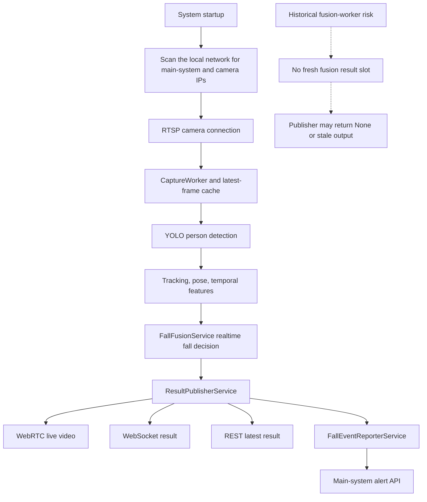
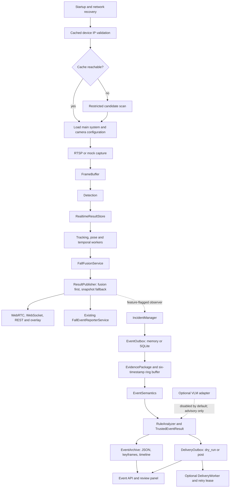
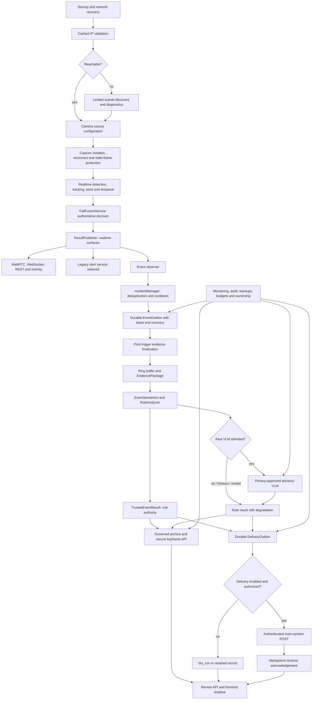

# Event Semantic Pipeline Final Delivery Pack

Date: 2026-07-18  
Audience: teachers, reviewers, project team, backend and operations engineers  
Scope: event-level semantic modelling side path for the camera service

## Executive Status

The realtime fall-detection chain remains authoritative. The event semantic
pipeline is an additive, feature-flagged side path that has been implemented
and locally accepted with replay, security, SQLite, and loopback mock tests.

Completed and verified:

- Device/realtime results can be observed by an event pipeline without
  replacing fusion, WebRTC, WebSocket, REST latest-result, or the legacy alert
  service.
- Candidate/confirmed event incidents, evidence packages, semantic records,
  rule-first trusted results, archive records, review APIs, and frontend review
  presentation are implemented.
- Keyframe access and archive retention have bounded security controls.
- DeliveryOutbox supports dry-run, SQLite persistence, idempotency, retry
  leases, read-only observability, and loopback mock POST tests.

Not enabled or not production-approved:

- Event pipeline, archive image serving, delivery worker, VLM, and DeliveryOutbox
  are disabled by default.
- No real main-system POST has been performed. DeliveryOutbox now supports the
  legacy configurable token header when both header name and token are set, but
  production POST remains blocked pending approvals and a controlled canary.
- A controlled real local Ollama smoke was run but is `REVISE`:
  `qwen-vision-cn:latest` timed out at 120 seconds and `qwen3.5:9b` returned
  invalid advisory JSON. `ollama_qwen` remains default-disabled, loopback-only,
  and text-only; no image, keyframe, local path, or image bytes are sent.
  External VLM use is not approved.
- P12 provides a read-only configuration safety gate. A passing check is not a
  production authorization and does not enable delivery, VLM, or keyframe
  serving.

## 1. Original Chain



The original path was optimized for frame-level realtime results and the legacy
alert channel. It had no event incident lifecycle, evidence package, semantic
review, archive governance, or durable delivery outbox.

## 2. Current Implemented Chain



The solid realtime line remains independent. The dashed event branch is active
only when its flags are enabled. `FallEventReporterService` remains present and
is not removed by this work.

## 3. Target Fully Optimized Chain



The right-side components are an intended target, not a declaration that they
are currently active. In particular, authenticated production POST and
privacy-approved VLM remain future work.

## 4. Implemented Capability Inventory

| Area | Current capability | State |
| --- | --- | --- |
| Network recovery | Cached camera/main-system address validation with constrained fallback discovery. | Implemented. |
| Realtime safety | Fusion-first result publishing with a snapshot fallback; WebRTC/WS/REST remain on the main chain. | Implemented. |
| Incident lifecycle | Candidate/confirmed fall observation, deduplication, cooldown, event IDs, outbox state transitions. | Implemented, default off. |
| Evidence | Ring buffer selects T-3s, T-1s, T0, T+1s, T+3s and T+5s evidence entries with missing-frame reasons. | Implemented, default off. |
| Semantics | Structured event semantics and rule-first trusted result. | Implemented, default off. |
| Archive | JSON/keyframe/timeline archive, per-camera retention and count limits, best-effort cleanup logs. | Implemented, default off. |
| Keyframe security | Default-deny serving gate, incident ID validation, relative-path containment, path redaction. | Implemented. |
| Event review UI | `/demo/` event semantic review panel, keyframe timeline and delivery status presentation. | Implemented when event data exists. |
| Delivery | Memory/SQLite outbox, dry-run, per-incident deduplication, lease-based retry worker and read-only API. | Implemented, default off. |
| Delivery authentication | Optional legacy-compatible token header, emitted only when both header name and token are non-empty. | Implemented and mock-tested; default off. |
| Mock delivery | Local loopback 200/500/timeout/non-JSON scenarios. | Accepted; not a real main-system test. |
| Post-event evidence | Default-disabled two-stage collector records later T+1/T+3/T+5 frames without blocking realtime output. | Implemented; real-camera completion acceptance pending. |
| VLM shell | disabled/dummy/http_mock/http adapter modes plus local `ollama_qwen`, prompt/schema validation and rule fallback. | Implemented; real provider smoke not run. |
| Production readiness | Read-only `.env`/source safety checker with JSON report and nonzero fail exit. | Implemented; configuration gate only. |

## 5. Default Closed Configuration

The distributed example configuration intentionally keeps the semantic branch
and external effects disabled:

```dotenv
EVENT_PIPELINE_ENABLED=false
EVENT_RING_BUFFER_ENABLED=false
EVENT_WORKER_ENABLED=false
EVENT_SEMANTIC_ENABLED=false
EVENT_VLM_ENABLED=false
EVENT_VLM_PROVIDER=dummy
EVENT_ARCHIVE_ENABLED=false
EVENT_KEYFRAME_SERVING_ENABLED=false
EVENT_DELIVERY_ENABLED=false
EVENT_DELIVERY_MODE=dry_run
EVENT_DELIVERY_BACKEND=memory
EVENT_DELIVERY_WORKER_ENABLED=false
MAIN_SYSTEM_ALERT_ENABLED=false
```

`EVENT_KEYFRAME_SERVING_ENABLED` is independently default-deny even when an
archive exists. Delivery and VLM are not activated merely by enabling the event
pipeline.

## 6. Acceptance Evidence

| Stage | Evidence | Result and limit |
| --- | --- | --- |
| P1 real event path | Local FastAPI replay acceptance with a historical fall replay. | Candidate-event path accepted: REST, WS, WebRTC, archive, event API and frontend worked. The replay produced `fallen_candidate`, not `fallen_confirmed`. |
| P1 keyframes | Six timeline slots returned; three pre/trigger images archived. | T+1/T+3/T+5 were missing because evidence finalized before future frames arrived. Known issue. |
| P2 security/governance | Keyframe path/ID/traversal, archive cleanup and realtime regression tests. | 27 focused tests and 107 event/realtime regression tests passed. |
| P3 dry-run/SQLite | Synthetic confirmed event, temporary SQLite, four delivery APIs, restart recovery. | `1 passed`; combined delivery/realtime regression `61 passed`; `requests.post` invocation count was zero. |
| P4 loopback mock POST | `127.0.0.1` mock server for 200, 500, timeout and non-JSON body. | `1 passed`; combined regression `61 passed`; no real main system contacted. |
| P5 production plan | Contract and configuration audit. | Production POST intentionally not enabled; the former DeliveryOutbox auth-header blocker was resolved in P8, while approvals and canary evidence remain required. |
| P6 VLM readiness | Adapter, contract and rule-fallback tests. | 25 passed; real VLM remains not approved. |
| P8 delivery token header | Mock POST header and retry regression tests. | Legacy-compatible header is sent only when both configured values exist; no real main system contacted. |
| P9 post-event keyframes | Timer-based collector, archive, keyframe API and event API regression tests. | Two-stage completion is implemented but has not yet proved a complete six-frame sequence on a real camera. |
| P10 confirmed pipeline | Synthetic `fallen_confirmed` event through evidence, semantics, archive and event APIs. | Pipeline exercise passed; real algorithm confirmed acceptance remains `NOT_RUN`. |
| P11 camera stability | Real RTSP readiness inspection. | `NOT_RUN`: no configured physical camera endpoint; no simulated result was presented as a real-camera result. |
| P12 production readiness | Read-only checker executed against `.env.example`; focused tests. | Safe default example passed; checker does not confer production approval. |
| P13 local Ollama smoke | One synthetic/redacted advisory request per installed local Qwen model. | `REVISE`: preferred model timed out; comparison model returned invalid JSON. No realtime/main-system impact and no production approval. |

P1 screenshot evidence is retained at
`tmp_event_visual_qa/event_pipeline_real_acceptance_20260718.png`. Browser
console had no errors in that replay acceptance. See the linked runbooks in
Section 12 for full conditions and test commands.

## 7. API Inventory

| API | Purpose | Notes |
| --- | --- | --- |
| `GET /events/status` | Event flags, worker state and event counts. | Safe while disabled. |
| `GET /events/outbox` | Event records with optional status/camera filters. | Read-only public payload redacts local paths. |
| `GET /events/latest?camera_id=` | Most recent event for a camera. | Read-only. |
| `GET /events/{incident_id}` | Event lifecycle, evidence, semantics, trusted result, archive and delivery summary. | Invalid IDs are rejected. |
| `GET /events/{incident_id}/keyframes/{selector}` | One archived keyframe by timeline selector. | Requires `EVENT_KEYFRAME_SERVING_ENABLED=true`; otherwise 404. |
| `GET /events/{incident_id}/keyframes/by-offset/{offset_ms}` | One archived keyframe by timestamp offset. | Same security gate and archive containment checks. |
| `GET /events/delivery/status` | Delivery flags, worker state and status counts. | Does not deliver or retry. |
| `GET /events/delivery/outbox` | Delivery records, filterable by status/camera. | Returns bounded summary, not raw payload. |
| `GET /events/delivery/{delivery_id}` | One delivery record summary. | Read-only. |
| `GET /events/delivery/by-incident/{incident_id}` | Delivery lookup by idempotency key. | Read-only. |
| `GET /integration/results/{camera_id}/latest` | Existing realtime latest result. | Main chain; exercised in P1. |
| `GET /ws/results?camera_id=` | Existing realtime result socket. | Main chain; exercised in P1. |
| `/demo/` | Existing frontend demo and event review surface. | Keyframe images still require serving gate. |

## 8. Data Shape Examples

### Event record summary

```json
{
  "incident_id": "vision-fall-camera_01-track-2-20260718012327-0004",
  "event_type": "fall_candidate",
  "fall_state": "fallen_candidate",
  "risk_level": "high",
  "status": "delivery_pending",
  "evidence_package": {
    "camera_id": "camera_01",
    "keyframes": [
      {"label": "T-3s", "available": true, "keyframe_url": "/events/<incident_id>/keyframes/t_minus_3s"},
      {"label": "T0", "available": true, "keyframe_url": "/events/<incident_id>/keyframes/t0"},
      {"label": "T+1s", "available": false, "missing_reason": "no_frame_near_target", "keyframe_url": null}
    ]
  },
  "trusted_result": {
    "review_result": "rule_only",
    "final_event_type": "fall_candidate",
    "final_risk_level": "medium"
  },
  "archive_path": null
}
```

The external API deliberately omits local `archive_path`; URLs are API-relative
identifiers, not local filenames.

### Delivery record summary

```json
{
  "delivery_id": "<uuid>",
  "incident_id": "<stable-incident-id>",
  "camera_id": "camera_01",
  "delivery_status": "dry_run_sent",
  "delivery_mode": "dry_run",
  "dry_run": true,
  "attempt_count": 0,
  "lock_owner": null,
  "lock_until": null,
  "payload_summary": {
    "event_type": "fall_confirmed",
    "state": "confirmed_fall",
    "status": "fallen_confirmed",
    "severity": "L3"
  }
}
```

### Proposed VLM advisory record

```json
{
  "scene_summary": "Advisory description of visible posture and motion.",
  "possible_false_positive_reason": "Possible sitting or occlusion; requires review.",
  "care_advice": "Inspect the live view and confirm onsite.",
  "confidence_explanation": "Evidence is limited because post-trigger frames are missing.",
  "advisory_only": true
}
```

This is a planned advisory schema, not a current authoritative VLM output or
production API guarantee.

## 9. Safe Enablement Steps

### Local/replay event review

1. Keep `MAIN_SYSTEM_ALERT_ENABLED=false`, `EVENT_DELIVERY_ENABLED=false`, and
   `EVENT_VLM_ENABLED=false`.
2. Enable `EVENT_PIPELINE_ENABLED`, `EVENT_RING_BUFFER_ENABLED`,
   `EVENT_WORKER_ENABLED`, `EVENT_SEMANTIC_ENABLED`, and, if needed,
   `EVENT_ARCHIVE_ENABLED` only in a local/test configuration.
3. Use a dedicated SQLite outbox path and archive directory for the test.
4. Keep `EVENT_KEYFRAME_SERVING_ENABLED=false` unless the host is restricted to
   the trusted internal demo network.
5. Verify `/events/status`, `/events/latest`, an event detail, the review panel
   and existing realtime REST/WS/WebRTC before considering the run accepted.
6. Before any production flag change, run the read-only readiness gate against
   the proposed configuration and resolve every `fail` finding:

   ```powershell
   .\.venv\Scripts\python.exe scripts\check_event_pipeline_production_readiness.py --env <proposed-env-file> --json
   ```

### Delivery progression

1. Run SQLite `dry_run` acceptance only.
2. Run loopback mock POST acceptance only.
3. Follow `event_delivery_production_activation_plan.md`; do not perform a
   real canary until the readiness check, approvals, and receiver contract are
   completed.

### VLM progression

1. Keep real providers disabled.
2. Use dummy or local mock tests with synthetic data.
3. Follow `event_vlm_activation_readiness.md`; privacy, media, concurrency and
   cost gates must be complete before any external provider is considered.

## 10. Rollback

For event review or archive exposure, set the relevant feature flags to false
and restart through the approved deployment process:

```dotenv
EVENT_KEYFRAME_SERVING_ENABLED=false
EVENT_ARCHIVE_ENABLED=false
EVENT_SEMANTIC_ENABLED=false
EVENT_WORKER_ENABLED=false
EVENT_RING_BUFFER_ENABLED=false
EVENT_PIPELINE_ENABLED=false
```

For a delivery incident, stop retry claims first, then the outbox side path:

```dotenv
EVENT_DELIVERY_WORKER_ENABLED=false
EVENT_DELIVERY_ENABLED=false
EVENT_DELIVERY_MODE=dry_run
```

Do not delete SQLite outbox/archive data during rollback. Preserve it for
diagnosis. `FallEventReporterService` remains in the deployment and must be
managed under its existing owner and approved configuration. For any VLM
concern, set `EVENT_VLM_ENABLED=false`; the rule pipeline continues without it.

## 11. Known Risks and Limits

| Risk or limit | Current state | Required follow-up |
| --- | --- | --- |
| Future evidence frames | P1 archived 3 of 6 images because the event finalized before the post-trigger window. P9 now provides a default-disabled two-stage timer collector. | Enable and validate the collector in replay/real-camera acceptance; only call six-frame evidence complete when its final status is `complete`. |
| Physical-camera validation | P1 used a local replay only. | Run a controlled real-camera/replay matrix without forcing thresholds. |
| Keyframe authorization | Serving is configuration-gated, not user-specific signed access. | Add authenticated/tokenized access before any wider network exposure. |
| Delivery authorization | Token-header capability is implemented, but formal receiver authorization, secret distribution and named approval are not yet evidenced. | Complete receiver-side review and a controlled single-camera canary before production POST. |
| Delivery response semantics | Any HTTP 2xx is treated as success; no required acknowledgement body. | Agree and implement a formal receiver acknowledgement contract if needed. |
| Duplicate alerts | Legacy and new delivery channels could both send if enabled together. | Select one authoritative sender per canary camera. |
| VLM privacy and cost | No real provider, media contract, privacy control, concurrency limit or cost budget. | Complete P6 gates before any external VLM call. |
| Operational ownership | Named approval, monitoring and rollback contacts are not stored in this repository. | Assign named project, security, operations and main-system owners. |

## 12. Handover References and Next Roadmap

Primary implementation and acceptance references:

- `docs/event_pipeline_real_acceptance_20260718.md`
- `docs/event_archive_security_runbook.md`
- `docs/event_delivery_dry_run_acceptance_20260718.md`
- `docs/event_delivery_mock_post_acceptance_20260718.md`
- `docs/event_delivery_production_activation_plan.md`
- `docs/event_vlm_activation_readiness.md`
- `docs/event_delivery_contract.md`
- `docs/event_vlm_adapter_contract.md`
- `docs/event_pipeline_production_readiness_check.md`
- `docs/qwen_ollama_real_smoke_20260718.md`

Recommended next order of work:

1. Fix the post-trigger keyframe completion window and repeat P1 with a
   controlled confirmed-fall replay and a physical-camera test.
2. Add authenticated access or short-lived signatures before keyframe sharing
   beyond a trusted internal demo network.
3. Complete receiver response semantics, secret distribution review, and an
   approved single-camera production canary. DeliveryOutbox token-header
   support has already been implemented and mock-tested.
4. Add delivery operations ownership, SQLite backup/retention monitoring and
   receiver-side idempotency verification.
5. P8-P12 implementation is complete. Remaining acceptance work is a real
   confirmed-fall replay, real-camera stability rounds, and an approved
   production readiness review using the read-only gate.
6. Repeat the P13 local Ollama smoke only after resolving the observed local
   latency and JSON-contract failures. Continue to use structured semantics
   only with image transfer explicitly disabled; `ollama_qwen` remains
   default-disabled and rejects non-loopback endpoints.
7. Complete VLM privacy/media, concurrency, circuit-breaker, telemetry and
   local resource-budget work; run only an advisory-only local canary.
8. Maintain rule/fusion authority throughout. Do not make VLM or delivery
   availability a prerequisite for realtime fall detection or alert decisions.
