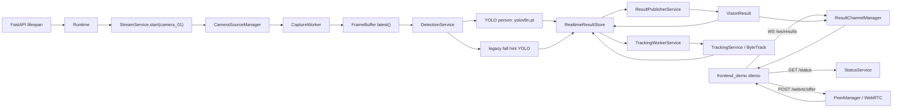
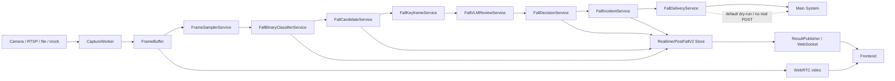
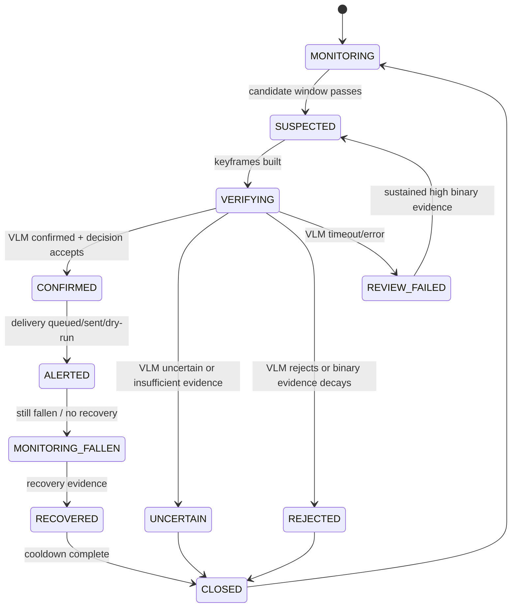

# Post-Fall V2 Architecture Audit

Audit target: `E:/国赛/camera-service`

Audit date: 2026-08-10

Scope: architecture and readiness audit only. This document does not declare the
new post-fall V2 pipeline as implemented or verified.

## 1. Current Real Main Chain

Current live profile observed from `/status`: `safe_demo`.

Current stream source: `mock://colorbars`.

Current active chain:



Current runtime facts from `/status`:

- `detection.enabled=true`
- `detection.loaded=true`
- `detection.model_name=yolov8n.pt`
- `pipeline_mode=legacy`
- `fall_hint_writer_source=DetectionService`
- `pose.pose_enabled=false`
- `behavior.enabled=false`
- `temporal.enabled=false`
- `event_pipeline_enabled=false`
- `event_delivery_enabled=false`
- `main_system_alert_enabled=false`
- `webrtc_clients=1`
- `ws_clients=1`

The current safe-demo path is a real local runtime path, but it is not a LIVE
camera validation.

## 2. Current Runtime Dependency Graph

`app/main.py` constructs all service objects inside FastAPI lifespan and stores
them in `app.state.runtime`.

```mermaid
flowchart TD
  Settings["Settings / .env"] --> Main["app.main.lifespan"]
  Main --> Device["DeviceConnectionService"]
  Main --> EventPipe["EventPipelineService"]
  Main --> SourceManager["CameraSourceManager"]
  Main --> RealtimeStore["RealtimeResultStore"]
  Main --> ResultStore["ResultStore"]
  Main --> ResultChannels["ResultChannelManager"]
  Main --> Tracking["TrackingService"]
  Main --> Identity["IdentityService / IdentityClient / Binding"]
  Main --> Pose["PoseService"]
  Main --> Behavior["BehaviorService"]
  Main --> Temporal["TemporalService"]
  Main --> Fusion["FallFusionService"]
  Main --> AlertOutbox["AlertOutboxService"]
  Main --> Reporter["FallEventReporterService"]
  Main --> Detection["DetectionService"]
  Main --> FallHintWorker["FallHintWorkerService"]
  Main --> TrackingWorker["TrackingWorkerService"]
  Main --> PoseWorker["PoseWorkerService"]
  Main --> TemporalWorker["TemporalWorkerService"]
  Main --> FusionWorker["FusionWorkerService"]
  Main --> Publisher["ResultPublisherService"]
  Main --> Stream["StreamService"]
  Main --> Peer["PeerManager"]
  Main --> Status["StatusService"]
  Main --> Runtime["Runtime dataclass"]

  SourceManager --> Stream
  Detection --> Stream
  RealtimeStore --> Detection
  RealtimeStore --> TrackingWorker
  RealtimeStore --> Publisher
  ResultChannels --> Publisher
  Reporter --> Publisher
  EventPipe --> Publisher
```



`Runtime.shutdown()` stops workers in reverse-ish order: delivery, event
pipeline, publisher, fusion, alert simulator, reporter, pose, temporal, identity
binding, tracking, fall-hint worker, detection, sources, WebRTC peers.

## 3. Old Fall Decision Entrances

Current old fall-related entrances are:

- `DetectionService`: runs `YoloPersonDetector` and, in `PIPELINE_MODE=legacy`,
  runs `YoloFallDetector` in the same detection worker.
- `FallHintWorkerService`: alternate async fall-hint path for
  `PIPELINE_MODE=async_v1`, currently disabled in `safe_demo`.
- `TrackingWorkerService`: merges fall-only detections into person detections
  when `fall_detector_promote_unmatched=true`; tracking can affect downstream
  fall object continuity.
- `ResultPublisherService`: merges detection, tracking, fall hints, optional
  pose, behavior, temporal, fall fusion, unified decision, and reporter metadata
  into `VisionResult`.
- `TemporalService` / `FallStateMachine`: old `normal -> unstable -> falling ->
  fallen` process-state logic; currently disabled.
- `FallFusionService` and `UnifiedFallDecisionEngine`: richer legacy scoring
  paths; currently disabled or shadow-disabled by config.
- `FallEventReporterService`: direct external alert path for confirmed falls;
  currently disabled.
- `EventPipelineService`: event archive / semantic / VLM / delivery path;
  currently disabled.

For V2 these should not be deleted in the first phase. They should be removed
from the active V2 fall-decision chain by feature flags and pipeline mode.

## 4. Binary Classifier Real State

Candidate binary classifier found:

- File:
  `models/showcase_assets/health1_demo/yolo_posture_person_binary_cls_best.pt`
- Framework/task from Ultralytics metadata: `task=classify`
- Class names from model metadata: `{0: "risk", 1: "safe"}`
- `imgsz` from model metadata: `384`
- Training data path embedded in model:
  `D:\Program\model\fall_detection\data_processed\fallpose_person_binary_cls`

Other related model assets:

- `models/showcase_assets/health1_demo/yolo_fall_detector_v1.pt`
  (`task=detect`, labels include `person`, `fall`, `fallen`, `sitting`,
  `lying`, `bending`)
- `models/external/syed-yolov11-le2i-fall/best.pt`
  (`task=detect`, labels `non-fall`, `fall`; marked research-only in
  `models/model_locator.json`)
- `models/external/human-fall-detection-yolo11/best.pt`
  (`task=detect`, labels `fallen`, `sitting`, `standing`; marked research-only)
- Current active legacy fall hint:
  `models/yolo_fall_hint_v2_plus_b012_best.pt`
  (`task=detect`, labels `falling`, `fallen`, `lying`, `sitting`, `bending`,
  `kneeling`, `standing`)

Current verification level for the binary classifier:

- Model format: confirmed as Ultralytics classification `.pt`.
- Label map: confirmed from model metadata as `risk/safe`.
- Input size: confirmed from model metadata as `384`.
- Preprocessing: NEEDS_VERIFICATION. Ultralytics classification defaults are
  implied, but the exact frame crop policy, RGB/BGR conversion boundary,
  resizing, normalization, and whether input must be full frame or person crop
  are not documented in the repo.
- Threshold: BLOCKED. No repo-controlled threshold calibration was found for
  this `risk/safe` classifier. Do not use `probability > 0.5` as final event
  threshold.
- Evaluation report: BLOCKED. No in-repo training or validation summary was
  found for `yolo_posture_person_binary_cls_best.pt`.
- Deployment state: not connected to current runtime chain.

The external dataset path exists on this machine, but it is outside the current
repository. It cannot be treated as deployable repo evidence until its training
config, split policy, metrics, preprocessing, and threshold calibration are
captured into repo-controlled artifacts.

## 5. VLM Real State

Existing VLM-related components:

- `app/events/vlm_adapter.py`
  supports `disabled`, `dummy`, `http_mock`, `http`, `qwen_http`, `ollama`,
  `qwen_ollama`, `ollama_qwen`.
- `OllamaVLMReviewAdapter` is localhost-guarded and text-only by default.
- `app/events/qwen_keyframe.py`
  provides `QwenKeyframeAnalyzer`, sends image bytes to localhost Ollama, and
  rejects path/URL/identifier leakage.
- `QwenKeyframeAdvisory` schema includes scene summary, posture description,
  movement description, possible false-positive reasons, care advice, and
  advisory confidence.

Current config state:

- `EVENT_VLM_ENABLED=false`
- `EVENT_QWEN_KEYFRAME_ANALYSIS_ENABLED=false`
- `QWEN_MEDIA_INPUT_ENABLED=false`
- `QWEN_MEDIA_PRIVACY_APPROVED=false`

V2 gap:

- Existing VLM schemas are advisory event-review schemas, not the requested V2
  strict schema with `verdict`, `confidence`, `person_state`, `scene_context`,
  `risk_flags`, `recommended_response`, and `summary`.
- No live local Qwen/Ollama call was made in this audit.
- VLM adapter existence does not prove VLM PASS.

## 6. Event / Delivery Real State

Reusable event components:

- `EventPipelineService`
- `RingFrameBuffer`
- `EvidencePackageBuilder`
- `EventArchive`
- `EventOutbox` / `SQLiteEventOutbox`
- `IncidentManager`
- `DeliveryOutbox`
- `DeliveryWorker`
- `build_main_system_payload`
- existing delivery tests for idempotency, retry, dry-run, auth headers, sqlite
  outbox, and payload compatibility.

Current config state:

- `EVENT_PIPELINE_ENABLED=false`
- `EVENT_DELIVERY_ENABLED=false`
- `EVENT_DELIVERY_MODE=dry_run`
- `MAIN_SYSTEM_ALERT_ENABLED=false`
- `FallEventReporterService.enabled=false`

Safety gates already present:

- `EVENT_DELIVERY_MODE=post` requires `EVENT_DELIVERY_POST_APPROVED=true`
- `EVENT_DELIVERY_TARGET_URL` is required for post mode
- main-system token header and token are required for post mode
- Qwen keyframe analysis requires localhost endpoint, approved media input, and
  event archive/keyframe JSON enabled.

V2 gap:

- Existing event pipeline observes `VisionResult` objects and legacy
  `fall_decision` states. It does not currently observe a post-fall binary
  candidate stream.
- Existing incident states are event outbox statuses, not the requested V2
  state machine.

## 7. Reusable Components

Directly reusable:

- FastAPI lifespan and `Runtime` container pattern.
- `Settings`, `.env` loading, `startup_safety_errors`, safe configuration
  snapshot.
- `StreamService`, `CameraSourceManager`, `CaptureWorker`,
  `SubprocessCaptureWorker`.
- `FrameBuffer` as the latest-frame source.
- WebRTC video serving through `PeerManager`.
- WebSocket publishing through `ResultChannelManager`.
- `StatusService` shape and `/status` diagnostics pattern.
- `RealtimeResultStore` pattern, with new slots needed for V2.
- `EventPipelineService` ideas: ring buffer, evidence package, archive, outbox.
- `DeliveryOutbox` / `DeliveryWorker` ideas: idempotency, retry, dry-run,
  sqlite backend.
- VLM safety patterns: localhost guard, strict schema, forbidden metadata/path
  filtering.
- Existing frontend event panel concepts, with schema changes required.

Reusable with caution:

- `FallEventReporterService` incident reuse/cooldown logic, but not its direct
  authority to POST alerts.
- `IncidentManager` concepts, but it is tied to current `FallEventRecord`
  fields and legacy fall states.
- `RingFrameBuffer`, but V2 keyframes must support post-fall-only startup and
  not require pre-fall context.

## 8. Components to Add

Proposed new services:

- `FrameSamplerService`
- `FallBinaryClassifierService`
- `FallCandidateService`
- `FallKeyframeService`
- `FallVLMReviewService`
- `FallDecisionService`
- `FallIncidentService`
- `FallDeliveryService`

Proposed new schemas:

- `SampledFrame`
- `FallBinaryPrediction`
- `FallCandidate`
- `FallKeyframePackage`
- `FallVLMReview`
- `FallDecision`
- `FallIncident`
- `FallDeliveryRecord`

Proposed new stores:

- `PostFallV2Store` or new `RealtimeResultStore` slots:
  `sampled_frames`, `binary_predictions`, `fall_candidates`, `keyframe_packages`,
  `vlm_reviews`, `fall_decisions`, `fall_incidents`.

## 9. Components to Exit Active Chain

In `post_fall_v2`, these must not be authorities for fall decision:

- legacy `YoloFallDetector`
- YOLO person detection as primary fall decision evidence
- ByteTrack as primary fall decision evidence
- Pose pipeline
- Behavior pipeline
- Temporal/LSTM pipeline
- `FallFusionService`
- old `normal -> unstable -> falling -> fallen` state machine
- `UnifiedFallDecisionEngine` primary write-back
- direct external alert from `FallEventReporterService`

They may remain available for rollback, display, diagnostics, or separate
non-authoritative enrichment.

## 10. V2 Complete Chain



## 11. Data Structure Design

Draft schema definitions:

```text
SampledFrame
- camera_id
- frame_seq
- sampled_at
- captured_at
- frame_width
- frame_height
- frame
- source_generation
- sample_reason

FallBinaryPrediction
- camera_id
- frame_seq
- model_path
- model_sha256
- model_task
- labels
- probabilities
- positive_label
- positive_probability
- preprocessing_profile
- threshold_profile
- status: OK | NEEDS_VERIFICATION | ERROR

FallCandidate
- candidate_id
- camera_id
- start_frame_seq
- end_frame_seq
- started_at
- updated_at
- positive_frame_count
- window_frame_count
- max_probability
- mean_probability
- evidence_frames
- cooldown_key
- status: OPEN | READY_FOR_REVIEW | COOLDOWN | EXPIRED

FallKeyframePackage
- candidate_id
- camera_id
- created_at
- keyframes:
  - first_positive
  - middle
  - highest_probability
  - latest
  - optional_context
- missing_reasons
- supports_post_fall_startup: true

FallVLMReview
- candidate_id
- schema_version
- verdict: confirmed_fall | rejected | uncertain
- confidence
- person_state
- scene_context
- risk_flags
- recommended_response
- summary
- provider
- latency_ms
- error_code
- raw_response_hash

FallDecision
- candidate_id
- incident_id
- decision: CONFIRMED | UNCERTAIN | REJECTED | REVIEW_FAILED | SUSPECTED_FALL | NEED_REVIEW
- reasons
- binary_evidence_summary
- vlm_review_summary
- confidence
- created_at

FallIncident
- incident_id
- camera_id
- state
- candidate_ids
- first_seen_at
- last_seen_at
- last_alerted_at
- cooldown_until
- recovery_status
- delivery_status
```

No schema should contain raw RTSP URLs, tokens, external secrets, or uncontrolled
file paths in public API payloads.

## 12. State Machine

Requested V2 incident state machine:



Important rule: VLM timeout/error must not default to `NON_FALL`. If binary
evidence remains sustained and high confidence, preserve `SUSPECTED_FALL` or
`NEED_REVIEW`.

## 13. Feature Flag Design

Current `PIPELINE_MODE` allows only:

- `legacy`
- `async_v1`
- `fall_disabled`

V2 needs a new explicit flag. Recommended design:

```dotenv
FALL_PIPELINE_MODE=legacy
# allowed: legacy, post_fall_v2

POST_FALL_V2_ENABLED=false
POST_FALL_V2_FRAME_SAMPLER_ENABLED=false
POST_FALL_V2_BINARY_CLASSIFIER_ENABLED=false
POST_FALL_V2_CANDIDATE_ENABLED=false
POST_FALL_V2_KEYFRAME_ENABLED=false
POST_FALL_V2_VLM_REVIEW_ENABLED=false
POST_FALL_V2_DECISION_ENABLED=false
POST_FALL_V2_INCIDENT_ENABLED=false
POST_FALL_V2_DELIVERY_ENABLED=false

POST_FALL_V2_SAMPLE_FPS=2
POST_FALL_V2_WINDOW_SECONDS=5
POST_FALL_V2_MIN_POSITIVE_FRAMES=3
POST_FALL_V2_PROBABILITY_THRESHOLD=
POST_FALL_V2_CANDIDATE_COOLDOWN_SECONDS=30
POST_FALL_V2_BINARY_MODEL_PATH=models/showcase_assets/health1_demo/yolo_posture_person_binary_cls_best.pt
POST_FALL_V2_BINARY_PREPROCESSING_PROFILE=NEEDS_VERIFICATION
POST_FALL_V2_BINARY_THRESHOLD_PROFILE=NEEDS_VERIFICATION
```

Safety defaults:

```dotenv
MAIN_SYSTEM_ALERT_ENABLED=false
EVENT_DELIVERY_ENABLED=false
POST_FALL_V2_DELIVERY_ENABLED=false
POST_FALL_V2_DELIVERY_MODE=dry_run
```

Do not extend active external POST behavior until there is a dedicated
integration stage.

## 14. File-Level Changeset

Expected V2 implementation files:

```text
app/post_fall_v2/__init__.py
app/post_fall_v2/schemas.py
app/post_fall_v2/frame_sampler_service.py
app/post_fall_v2/binary_classifier_service.py
app/post_fall_v2/candidate_service.py
app/post_fall_v2/keyframe_service.py
app/post_fall_v2/vlm_review_service.py
app/post_fall_v2/decision_service.py
app/post_fall_v2/incident_service.py
app/post_fall_v2/delivery_service.py
app/post_fall_v2/store.py
app/post_fall_v2/status.py
app/api/post_fall_v2_api.py
```

Expected modifications:

```text
app/core/config.py
app/core/runtime.py
app/main.py
app/services/stream_service.py
app/services/status_service.py
app/services/result_publisher_service.py
frontend_demo/app.js
frontend_demo/overlay.js
configs/safe_demo.env
configs/production_candidate.env
docs/configuration_reference.md
```

Expected tests:

```text
tests/test_post_fall_v2_frame_sampler.py
tests/test_post_fall_v2_binary_classifier_config.py
tests/test_post_fall_v2_candidate_service.py
tests/test_post_fall_v2_keyframe_service.py
tests/test_post_fall_v2_vlm_schema_guard.py
tests/test_post_fall_v2_decision_service.py
tests/test_post_fall_v2_incident_service.py
tests/test_post_fall_v2_delivery_dry_run.py
tests/test_post_fall_v2_status_contract.py
tests/test_post_fall_v2_pipeline_mode.py
```

## 15. Test Plan

UNIT:

- Frame sampler cadence without hard-coded FPS.
- Binary classifier refuses to run when preprocessing or threshold profile is
  `NEEDS_VERIFICATION`, unless explicitly set to evaluation-only.
- Candidate window requires multiple positive frames.
- Single-frame fall does not create incident.
- Keyframe package works when only post-fall frames exist.
- VLM output schema rejects medical diagnosis and forbidden path/URL fields.
- VLM timeout creates `REVIEW_FAILED` or `NEED_REVIEW`, not `NON_FALL`.
- Incident dedup prevents repeated alerts during continuous fallen state.
- Delivery dry-run does not POST.

MOCK:

- Mock binary classifier emits controlled probability sequence.
- Mock VLM emits confirmed/rejected/uncertain/error cases.
- Mock delivery records idempotency and retry states.

SYNTHETIC:

- Synthetic frame sequences with post-fall-only startup.
- Synthetic recovery sequence.
- Synthetic no-person or empty-scene sequence.

REPLAY:

- Use recorded videos and archived frame sequences.
- Report every replay result as REPLAY, not LIVE.
- Compare candidate timing, keyframes, VLM request payload, and incident states.

LIVE:

- Only after explicit approval.
- Requires real camera, approved privacy handling, external delivery still
  disabled first.
- Live PASS cannot be inferred from mock or replay.

## 16. Risks

- The only obvious binary classifier is a showcase model, not a runtime model.
- The binary classifier label `risk/safe` is not identical to `fall/non-fall`;
  semantic mapping requires verification.
- Full-frame versus person-crop input is unresolved.
- `FrameBuffer` only stores latest frame; V2 keyframe service needs either a
  ring buffer enabled independently of legacy event pipeline or its own cache.
- Current event pipeline depends on legacy `fall_decision` fields.
- Current frontend assumes `VisionResult.objects[*].fall_decision` and
  `alarm_preview` for risk display.
- VLM schemas are advisory and not the requested V2 authoritative review schema.
- External delivery has two existing paths (`FallEventReporterService` and
  `DeliveryOutbox`), so V2 must choose one controlled path to avoid duplicate
  sends.
- `PIPELINE_MODE` currently rejects `post_fall_v2`; config migration must be
  staged.

## 17. BLOCKED Items

BLOCKED / NEEDS_VERIFICATION:

- Binary classifier preprocessing profile.
- Binary classifier threshold calibration.
- Binary classifier validation metrics and split definition.
- Whether binary classifier input should be full frame, person crop, or another
  crop produced by the earlier model pipeline.
- Whether `risk` maps to post-fall abnormal state rather than generic posture
  risk.
- Whether current local Qwen/Ollama endpoint and model are installed and
  available.
- Whether requested V2 VLM schema can be satisfied by the existing local model
  without prompt/schema iteration.
- LIVE camera validation.
- Real external delivery integration.

Not blocked:

- Creating V2 service skeleton behind disabled flags.
- Creating schemas and unit tests.
- Creating mock/synthetic/replay harnesses.
- Implementing dry-run incident and delivery state machines.

## 18. Staged Implementation Recommendation

Stage A: config and schemas only.

- Add `FALL_PIPELINE_MODE` and V2 feature flags with safe defaults.
- Add V2 schemas and unit tests.
- No runtime behavior change.

Stage B: frame sampler and binary classifier in audit/shadow mode.

- Implement sampler.
- Implement classifier loader with explicit `NEEDS_VERIFICATION` guard.
- Emit status only; no incident creation.

Stage C: candidate and keyframe package.

- Add sliding-window candidate logic.
- Add keyframe cache supporting post-fall-only startup.
- Unit, mock, synthetic tests.

Stage D: VLM review service.

- Add strict V2 schema.
- Use localhost-only VLM.
- Timeout/error produces `REVIEW_FAILED` or `NEED_REVIEW`.
- No external delivery.

Stage E: decision and incident state machine.

- Implement dedup, cooldown, update, recovery.
- Publish V2 status to frontend.
- Keep legacy chain rollback path.

Stage F: delivery dry-run.

- Reuse delivery/outbox concepts.
- Record dry-run payloads.
- No real POST.

Stage G: replay validation.

- Run controlled replay packs.
- Calibrate binary thresholds.
- Document REPLAY results.

Stage H: live and integration preparation.

- Only after explicit approval.
- Keep external delivery disabled until staging contract and tokens are
  approved.

## Final Audit Conclusion

Conclusion: POST_FALL_V2_AUDIT_READY

- Business code modified: no.
- Real configuration modified: no.
- Real external system called: no.
- Real binary classifier found: yes, candidate found at
  `models/showcase_assets/health1_demo/yolo_posture_person_binary_cls_best.pt`.
- Preprocessing confirmed: no, NEEDS_VERIFICATION.
- Threshold confirmed: no, BLOCKED.
- VLM adapter confirmed: partially. Existing adapter code and safety gates are
  confirmed; live provider availability and V2 schema suitability are not
  confirmed.
- Next stage allowed: Stage A only by default: add V2 flags, schemas, service
  skeletons, and tests behind disabled defaults. Do not enable external POST,
  do not claim model PASS, and do not remove legacy code.
