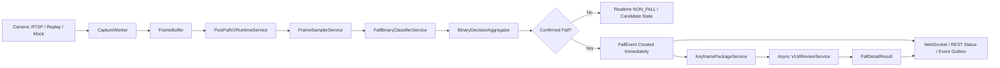

# Post-Fall V2 Binary-First Runtime Architecture

## Status

Post-Fall V2 has been promoted from a shadow JSONL evidence path to an engineering runtime path behind:

```text
PIPELINE_MODE=post_fall_v2
POST_FALL_V2_ENABLED=true
```

The system focus is post-fall state recognition: it first decides whether the current video stream is `FALL` or `NON_FALL`. It does not try to make the old legacy chain the authority for the exact falling instant.

## Formal Runtime Flow



## Binary Authority

In `PIPELINE_MODE=post_fall_v2`, final fall authority belongs to:

```text
FallBinaryClassifierService -> BinaryDecisionAggregator
```

The model contract remains:

```text
class 0 = noFall -> runtime label NON_FALL
class 1 = Fall   -> runtime label FALL
input = full camera frame, BGR converted to RGB, 224x224 letterboxed tensor
```

`NON_FALL` is not renamed to a model-level `Standing` class because the training label can include walking, sitting, bending, normal lying, and other non-fall states.

## Aggregation Rules

Single-frame `FALL` does not create an event. The aggregator requires a rolling window with:

```text
POST_FALL_V2_WINDOW_SIZE
POST_FALL_V2_MIN_POSITIVE_FRAMES
POST_FALL_V2_MIN_CONSECUTIVE_FRAMES
POST_FALL_V2_CANDIDATE_MIN_MS
```

Once confirmed, continued lying remains one active incident. A new incident can only be created after stable recovery and cooldown:

```text
POST_FALL_V2_RECOVERY_MIN_MS
POST_FALL_V2_COOLDOWN_MS
```

The current default threshold is:

```text
0.3979087471961975
```

This is an engineering/default threshold and is `NOT_PRODUCTION_CALIBRATED`.

## VLM Role

VLM is post-confirmation enrichment only:

```text
NON_FALL -> zero VLM calls
FALL_CONFIRMED -> FallEvent immediately -> async VLM detail review
VLM failure/timeout -> FallEvent remains valid
one incident -> at most one active VLM analysis
```

The VLM should describe post-fall details such as posture, movement, attempted standing, visibility, occlusion, help gesture, and scene risks. It must not override the binary `FallConfirmed` decision.

## Legacy Boundary

Legacy modules remain for rollback, debug, and comparison:

```text
DetectionService
YOLO fall hint
Tracking
Pose
Temporal / LSTM
FallFusion
Legacy state machine
```

In `PIPELINE_MODE=post_fall_v2`, `StreamService` starts capture plus `PostFallV2RuntimeService`; it does not start the legacy detection/fusion publisher chain as final fall authority.

## Production Blockers

Engineering runtime is implemented, but production acceptance still requires:

```text
Target-camera domain validation: NOT_RUN / BLOCKED
Production threshold transfer: NOT_VERIFIED
Real RTSP E2E acceptance: NOT_RUN
Real main-system POST: NOT_RUN and still disabled/dry-run by config
```
