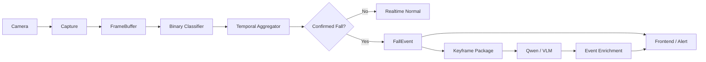

# Post-Fall V2 Binary-First 主链重构完成报告

## 1. 最终状态

`ENGINEERING_COMPLETE`

当前系统已经可以按以下功能定义描述：

> 视频流进入系统后，首先由轻量级二分类模型持续判断当前画面属于 `FALL` 还是 `NON_FALL`，并通过连续多帧结果完成稳定确认。只有确认发生跌倒后，系统才会创建跌倒事件并提取事件前后的关键帧，交由本地 Qwen/VLM 进一步分析倒地姿态、活动状态、起身情况和环境风险，最终形成结构化事件并推送至前端和后续告警链路。旧版 YOLO 跌倒提示、姿态、LSTM 和融合逻辑不再参与 `post_fall_v2` 模式下的最终跌倒判定。

生产验收仍需单独完成：

```text
ENGINEERING_IMPLEMENTATION = COMPLETE
TARGET_CAMERA_CALIBRATION = NOT_RUN / BLOCKED
PRODUCTION_THRESHOLD = NOT_VERIFIED
PRODUCTION_E2E = NOT_RUN
```

## 2. 修改后的核心链路

视频流进入后，第一层 AI 决策是 `FallBinaryClassifierService` 的 EfficientNet-B0 ONNX 二分类推理，而不是旧版 YOLO fall hint、Pose、LSTM 或 Fusion。

运行链路：

```text
Camera / RTSP / Replay / Mock
-> CaptureWorker
-> FrameBuffer
-> PostFallV2RuntimeService
-> FrameSamplerService
-> FallBinaryClassifierService
-> BinaryDecisionAggregator
-> NON_FALL: 不调用 VLM，继续实时检测
-> FALL_CONFIRMED: 创建 FallEvent，立即发布，再异步进入 VLM 细判
```

## 3. Mermaid 架构图



## 4. 修改文件

| 文件 | 修改原因 | 主要变化 |
|---|---|---|
| `app/core/config.py` | 增加正式 runtime mode 与参数 | 支持 `PIPELINE_MODE=post_fall_v2`、二分类阈值、窗口、恢复、冷却、VLM 参数；阈值标记为非生产校准 |
| `app/main.py` | 注入正式主链服务 | 创建并挂载 `PostFallV2RuntimeService` |
| `app/core/runtime.py` | 生命周期管理 | 保存并关闭 Post-Fall V2 runtime |
| `app/services/stream_service.py` | 主链隔离 | `post_fall_v2` 模式启动 capture + binary runtime，不启动 legacy detection/publisher 主决策链 |
| `app/services/status_service.py` | 可观测性 | `/status` 暴露 `workers.post_fall_v2_runtime` |
| `app/post_fall_v2/schemas.py` | 统一数据契约 | 增加 `BinaryFrameResult`、`BinaryAggregateDecision`、`FallEvent`、`FallDetailResult` 等 |
| `app/post_fall_v2/post_fall_runtime_service.py` | 正式主链编排 | 串联采样、二分类、聚合、事件、关键帧、VLM、发布；VLM 完成后再发布富化结果 |
| `app/api/event_api.py` | 前端隐私摘要 | 允许安全相对 `archive_summary.timeline_image_path`，继续过滤敏感字段 |
| `app/camera/capture_worker.py` | 全量回归修复 | 本地 replay EOF 保留 `disconnected`；mock fault 切换更稳定 |
| `scripts/check_pose_production_preflight.py` | 全量回归修复 | CUDA 阻断优先级更明确；live pose model 支持 basename/suffix 匹配 |
| `tools/fall_hint_labeler/server.py` | 全量回归修复 | 进度统计认可 meta `reviewed` 和坏 JSON 的已审阅语义 |
| `.env.example` | 配置样例 | 增加 Post-Fall V2 runtime 配置 |
| `configs/safe_demo.env` | 安全演示配置 | 增加默认关闭的 Post-Fall V2 配置块 |
| `requirements-dev.txt` | 测试依赖 | 明确 `httpx>=0.27`，未引入 `httpx2` |

## 5. 新增文件

| 文件 | 作用 |
|---|---|
| `app/post_fall_v2/binary_decision_aggregator.py` | 多帧二分类聚合、候选、确认、恢复、冷却、去重 |
| `app/post_fall_v2/rolling_event_buffer.py` | 有界事件帧缓存 |
| `app/post_fall_v2/keyframe_package_service.py` | 根据确认时间提取前后关键帧包 |
| `app/post_fall_v2/vlm_review_service.py` | VLM 细判统一接口、超时和失败保护 |
| `app/post_fall_v2/post_fall_runtime_service.py` | Binary-First 正式 runtime 编排器 |
| `tests/test_post_fall_v2_binary_decision_aggregator.py` | 聚合器状态机测试 |
| `tests/test_post_fall_v2_runtime_service.py` | Runtime、VLM 门控、失败保护、富化发布测试 |
| `tests/test_post_fall_v2_stream_mode_isolation.py` | `post_fall_v2` 与 legacy 主链隔离测试 |
| `docs/post_fall_v2_binary_first_runtime_architecture.md` | 架构说明 |
| `docs/post_fall_v2_binary_first_runtime_completion_report.md` | 本完成报告 |

## 6. 删除文件

未删除文件。Legacy 模块保留用于 rollback、debug、对照实验和历史测试。

## 7. Binary 判定逻辑

模型契约：

```text
ONNX: models/post_fall_v2/efficientnet_b0/fall_candidate_efficientnet_b0.onnx
input: input [batch, 3, 224, 224]
output: logits [batch, 2]
class 0 = noFall -> runtime label NON_FALL
class 1 = Fall   -> runtime label FALL
input policy = FULL_FRAME_TRAIN_MATCHED
```

核心参数：

```text
POST_FALL_V2_BINARY_THRESHOLD=0.3979087471961975
POST_FALL_V2_WINDOW_SIZE=8
POST_FALL_V2_MIN_POSITIVE_FRAMES=4
POST_FALL_V2_MIN_CONSECUTIVE_FRAMES=3
POST_FALL_V2_CANDIDATE_MIN_MS=800
POST_FALL_V2_RECOVERY_MIN_MS=1500
POST_FALL_V2_COOLDOWN_MS=3000
```

判定规则：

```text
单帧 FALL -> FALL_CANDIDATE，不创建事件
窗口内满足 positive count + consecutive count + candidate duration -> FALL_CONFIRMED / EVENT_ACTIVE
持续倒地 -> 仍是同一个 incident
稳定 NON_FALL 达到 recovery -> 进入 cooldown
cooldown 完成 -> re-arm，允许第二次跌倒生成第二个 incident
```

当前阈值是工程默认阈值，`NOT_PRODUCTION_CALIBRATED`。

## 8. VLM 逻辑

触发条件：

```text
NON_FALL -> zero VLM calls
FALL_CANDIDATE -> zero VLM calls
FALL_CONFIRMED / event_created -> one async VLM analysis
```

VLM 职责：

```text
分析跌倒后的详细情况，不重新决定“是否跌倒”
输出 posture、movement_level、attempt_to_stand、persistent_ground_state、visibility、occlusion、scene_risks、possible_help_gesture、summary、review_points
```

失败策略：

```text
VLM timeout -> FallEvent remains valid, vlm_status=timeout
VLM failure -> FallEvent remains valid, vlm_status=failed
one incident -> at most one active VLM call
```

前端时序：

```text
FallConfirmed 立即发布
VLM 完成后再发布带 vlm_status / vlm_summary 的富化结果
```

## 9. Legacy 状态

`PIPELINE_MODE=legacy`：

```text
Legacy detection / tracking / pose / temporal / fusion 保持原行为
```

`PIPELINE_MODE=post_fall_v2`：

```text
Legacy 不再拥有最终跌倒判定权
DetectionService 不作为主决策链启动
YOLO fall hint / Pose / Temporal / LSTM / Fusion 不触发新的正式 FallEvent
Shadow binary 仍可保留为 debug / evidence，不是正式主链
```

## 10. Runtime 配置

工程启动方式：

```powershell
$env:PIPELINE_MODE="post_fall_v2"
$env:POST_FALL_V2_ENABLED="true"
$env:POST_FALL_V2_VLM_ENABLED="true"   # 仅需要 VLM 细判时开启
.\.venv\Scripts\python.exe -m uvicorn app.main:app --host 127.0.0.1 --port 8000
```

安全边界：

```text
EVENT_DELIVERY_ENABLED=false 默认不做真实主系统 POST
MAIN_SYSTEM_ALERT_ENABLED=false 默认不发送真实告警
真实 RTSP、主系统 URL、token、摄像头密码未写入样例配置
```

## 11. 测试结果

已执行：

```text
.\.venv\Scripts\python.exe -m pytest -q
717 passed, 0 failed, 0 skipped, 2 warnings
```

相关组：

```text
Post-Fall / Event / VLM / Service / 回归相关组:
133 passed, 0 failed, 0 skipped, 1 warning

Compile check:
python -m compileall app\post_fall_v2 app\core app\services app\api app\camera scripts tools\fall_hint_labeler -q
PASS
```

两个 warning 均非本次主链失败：

```text
Starlette TestClient 建议 httpx2 的弃用提醒
tests/test_evaluate_fall_lstm_metrics.py::test_schema 返回非 None 的 pytest 提醒
```

## 12. 关键场景验收

| 场景 | 状态 | 证据 |
|---|---|---|
| Normal / NON_FALL | PASS | `test_non_fall_stream_publishes_no_event_and_zero_vlm_calls` |
| Single false positive | PASS | `test_single_positive_frame_does_not_confirm` |
| Confirmed fall | PASS | `test_sustained_positive_frames_confirm_once`、runtime confirmed 测试 |
| Fall + lying 10s | PASS | `test_continued_fall_does_not_duplicate_event` |
| Recovery | PASS | `test_recovery_and_cooldown_rearm` |
| Second fall | PASS | `test_second_fall_after_recovery_creates_second_incident` |
| VLM timeout | PASS | `test_vlm_timeout_does_not_remove_fall_event` |
| VLM failure | PASS | `test_vlm_failure_does_not_remove_fall_event` |
| VLM 完成后富化发布 | PASS | `test_vlm_completion_republishes_enriched_result_after_confirmed_event` |
| Legacy isolation | PASS | `test_post_fall_v2_stream_starts_binary_runtime_not_legacy_detection` |
| Event / Publisher 接收 FallEvent | PASS | Runtime event outbox + realtime publish tests |
| 真实 RTSP E2E | NOT_RUN | 需要目标摄像头现场数据 |
| 真实主系统 POST | NOT_RUN | 默认仍 disabled / dry-run |

## 13. 仍未完成的真实生产条件

```text
正式目标摄像头域验证: NOT_RUN / BLOCKED
生产 threshold transfer: NOT_VERIFIED
目标场景 hard negative 数据: NOT_RUN
真实 RTSP 长时间 E2E: NOT_RUN
真实 Ollama/Qwen 多模态在线验收: NOT_RUN
真实主系统 POST: NOT_RUN
```

这些不影响本轮工程主链完成，但不能把 replay/mock PASS 写成 production PASS。

## 14. 最终六项结论

【当前真正运行的新主链】

`PIPELINE_MODE=post_fall_v2` 下运行的是 `CaptureWorker -> FrameBuffer -> PostFallV2RuntimeService -> Binary Classifier -> BinaryDecisionAggregator -> FallEvent -> VLM enrichment`。

【二分类是否已成为第一判定层】

是。第一层 AI 判定是 EfficientNet-B0 ONNX 二分类，输出业务标签 `FALL / NON_FALL`。

【Legacy 是否已经失去最终跌倒判定权】

是。在 `post_fall_v2` 模式下 legacy detection/fusion/publisher 不作为最终跌倒主链启动；保留为 legacy 模式、debug、对照和回滚。

【Fall 后是否能够自动进入 VLM】

是。只有 `FALL_CONFIRMED` 创建事件后才异步进入 `VLMReviewService`；`NON_FALL` 和短暂候选不会调用 VLM。

【持续倒地是否只产生一次事件】

是。`EVENT_ACTIVE` 状态复用同一个 `incident_id`，持续 FALL 不重复创建事件，不重复调用 VLM；恢复和冷却完成后才 re-arm。

【当前还差什么才能称为生产验收通过】

还差目标摄像头真实域数据、生产阈值迁移、真实 RTSP 长时间 E2E、真实 VLM 在线验收和真实主系统 POST 预生产验收。
