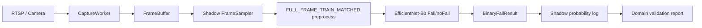

# Post-Fall V2 Binary Model Rebase Report

Stage: `P1B_BINARY_MODEL_REBASE_AND_DOMAIN_AUDIT`

Date: 2026-08-10

Scope: uploaded model audit, asset rebase, and offline verification only. This
stage does not connect Post-Fall V2 into Runtime, does not modify `.env`, does
not enable VLM, and does not call any external system.

Final gates:

- `POST_FALL_V2_BINARY_ARTIFACT_CONTRACT_READY`
- `POST_FALL_V2_BINARY_DOMAIN_VALIDATION_BLOCKED`

## 1. Previous Candidate

Previous P1 candidate:

`models/showcase_assets/health1_demo/yolo_posture_person_binary_cls_best.pt`

Verified previous identity:

- Framework/task: Ultralytics classification `.pt`
- Classes: `0=risk`, `1=safe`
- SHA256:
  `a5300114188aa6ef95ff5b5d0e08af124f5670cb927dc91b42f10e94da825bf1`
- Preprocessing: `Resize(384) -> CenterCrop(384) -> ToTensor -> Normalize(0,1)`
- Main blocker: `risk/safe` is posture-risk semantics, not explicit Fall/noFall.

Previous gate:

`POST_FALL_V2_BINARY_CONTRACT_BLOCKED`

## 2. New Uploaded Candidate

User-supplied package:

`D:/WeChat/xwechat_files/wxid_k047egb6o87f22_adc9/msg/file/2026-08/dog.zip`

The package was extracted only to an audit workspace first:

`E:/.../_uploaded_binary_model_audit_20260810_01/dog`

Then the selected model assets and small evidence files were copied into the
current project:

`models/post_fall_v2/efficientnet_b0/`

Copied files:

- `fall_candidate_efficientnet_b0.onnx`
- `best_model.pth`
- `model_selection.json`
- `summary.json`
- `deployment_verification.json`
- `fall_candidate_efficientnet_b0.verification.json`
- `dataset_audit.json`
- `dataset_manifest.csv`
- `group_oof_predictions.json`
- `MODEL_CARD.md`

Training images were not copied into the project.

## 3. Model Comparison

| Item | Previous P1 candidate | Uploaded candidate |
| --- | --- | --- |
| Format | Ultralytics `.pt` | PyTorch checkpoint + ONNX |
| Architecture | YOLO classification model | EfficientNet-B0 |
| Labels | `risk/safe` | `noFall/Fall` |
| Positive class | `risk` | `Fall` |
| Input policy | person/posture crop evidence | full frame evidence |
| Image size | `384x384` center crop | `224x224` resize + pad |
| Threshold evidence | blocked / external | group OOF evidence present |
| V2 fit | legacy or alternative candidate | preferred V2 binary candidate |

## 4. Selected V2 Candidate Recommendation

Recommendation:

`V2_SELECTED_BINARY_CANDIDATE = efficientnet_b0`

The previous `risk/safe` model should be retained only as:

`LEGACY_OR_ALTERNATIVE_BINARY_CANDIDATE`

Reason: the uploaded model directly matches the V2 first-stage question:

`Is the current full frame a Fall candidate state?`

This recommendation is for offline/shadow stages only. It is not approval for
active Runtime use.

## 5. Model Identity

Verified from `fall_pipeline/model.py`, checkpoint metadata, and
`outputs/model_selection.json`:

- Architecture: `efficientnet_b0`
- Classifier head: 2 output classes
- Parameters: `4,010,110`
- Checkpoint tensors: `360`
- Training image size: `224`
- Dropout: `0.2`
- Final checkpoint was refit on all 185 development images after OOF selection.

## 6. SHA256

Verified on project-copied assets:

- `models/post_fall_v2/efficientnet_b0/fall_candidate_efficientnet_b0.onnx`
  - SHA256:
    `e9871cdb4687055fb5d934dd994c2ad883adac0c2acab375c240f8e005ee04cc`
  - Size: `16,030,443 bytes`

- `models/post_fall_v2/efficientnet_b0/best_model.pth`
  - SHA256:
    `e2c2cf6f2cd6324ad9199bdb32922d11e3638ed81d218adbc5033c6e98cb5b94`
  - Size: `16,341,049 bytes`

Both match the expected values from the user-supplied audit prompt.

## 7. Input Contract

ONNX Runtime inspection on the copied project asset:

```text
input:  name=input,  shape=[batch,3,224,224], type=tensor(float)
output: name=logits, shape=[batch,2],         type=tensor(float)
```

Input tensor contract:

- RGB image
- `float32`
- NCHW
- dynamic batch
- per-image shape `3x224x224`

## 8. Preprocessing

Verified from `fall_pipeline/data.py` and `infer_onnx.py`:

```text
RGB
-> LongestMaxSize(max_size=224, interpolation=cv2.INTER_AREA)
-> PadIfNeeded(min_height=224, min_width=224,
               border_mode=cv2.BORDER_REFLECT_101,
               position=center)
-> Normalize(mean=(0.485,0.456,0.406),
             std=(0.229,0.224,0.225))
-> ToTensor
-> float32 NCHW
```

This preprocessing is not compatible with the previous Ultralytics
`Resize(384) -> CenterCrop(384)` path. They must not be mixed.

## 9. Output Contract

The ONNX model outputs two-class logits:

```text
logits[0] = noFall logit
logits[1] = Fall logit
```

Runtime score definition for future shadow adapter:

```text
fall_probability = softmax(logits)[1]
```

Offline smoke inference with the copied model confirmed score direction:

- real Fall sample: `fall_probability ~= 0.9999187`, candidate `true`
- real noFall sample: `fall_probability ~= 0.0125437`, candidate `false`

## 10. Class Mapping

Verified from `fall_pipeline/data.py` and checkpoint metadata:

| Index | Class |
| ---: | --- |
| 0 | `noFall` |
| 1 | `Fall` |

This is a direct semantic improvement over `risk/safe`.

## 11. OOF Threshold Evidence

Verified from:

- `model_selection.json`
- `summary.json`
- `group_oof_predictions.json`
- checkpoint metadata

Threshold:

`BINARY_CANDIDATE_THRESHOLD_OOF = 0.3979087471961975`

OOF protocol:

`three recording-group-held-out folds; final deployment checkpoints use all 185 images`

EfficientNet-B0 OOF metrics:

| Metric | Value |
| --- | ---: |
| Recall | `1.0` |
| Precision | `0.810126582278481` |
| Specificity | `0.8760330578512396` |
| Accuracy | `0.918918918918919` |
| ROC-AUC | `0.9904442148760331` |
| TP / FP / TN / FN | `64 / 15 / 106 / 0` |
| ONNX CPU P95 | `5.126 ms` |

This threshold is a candidate screening operating point, not a production
fall-alert threshold.

## 12. Dataset Audit

Verified from `dataset_audit.json` and `dataset_manifest.csv`:

- Total images: `185`
- Fall: `64`
- noFall: `121`
- Recording groups: `12`
- Invalid images: `0`
- Exact duplicates: `0`
- Cross-split dHash near duplicates `<=2`: `0`
- Leakage-free by group: `true`

Split counts:

| Split | Fall | noFall | Total |
| --- | ---: | ---: | ---: |
| train | 26 | 49 | 75 |
| val | 22 | 42 | 64 |
| test | 16 | 30 | 46 |

Positive Fall groups are only:

- `go2_fall_batch50_3min_20260731_210528`
- `go2_fall_batch50_3min_20260731_211034`
- `go2_fall_batch70_3min_20260731_212052`

The package itself warns that only three positive recording groups exist.

## 13. Hard Negative Coverage

Manual image sampling and filename/group inspection show that noFall data is
mostly standing/walking/upright activity from low-view Go2 recordings.

Coverage is insufficient for these important non-fall states:

- normal lying on bed
- normal lying on sofa
- intentional rest on floor
- exercise/stretching
- sitting on floor
- kneeling
- bending while doing chores
- occluded low posture
- night or low-light elderly-home scenes

Gate finding:

`HARD_NEGATIVE_COVERAGE_INSUFFICIENT`

The class name `noFall` is semantically clearer than `safe`, but it does not by
itself prove coverage of all non-fall elderly-care postures.

## 14. Camera Domain Risk

Observed source domain:

- Go2-style filenames and camera perspective
- low camera height
- close indoor room and hallway views
- person scale often large or partial
- limited people, clothing, lighting, and room diversity

Target system domain:

- fixed RTSP elderly-care camera
- likely `2304x1296`
- room-scale view
- older adults
- bed/sofa/floor recovery scenes
- day/night lighting variation

Gate finding:

`CAMERA_DOMAIN_SHIFT_RISK`

The model contract is ready, but camera-domain validation is not ready.

## 15. Frame Input Policy

Training/inference code supports full-frame classification:

```text
camera frame
-> RGB
-> aspect-ratio preserving resize
-> reflect padding
-> 224x224
-> EfficientNet-B0
```

Therefore the next shadow baseline must be:

`FULL_FRAME_TRAIN_MATCHED`

Do not make YOLO person crop a required precondition for this model. That would
create train/inference mismatch and would reintroduce YOLO person detection as a
single-point dependency.

Future ROI experiments are allowed only as:

`EXPERIMENTAL_PERSON_ROI`

## 16. Existing VLM Reference Audit

Uploaded reference files:

- `fall_vlm_pipeline.py`
- `live_fall_monitor.py`
- `realtime_fall_service.py`
- `prewarm_ollama.py`

Useful reference patterns:

- ONNX Runtime session reuse
- local Ollama/Qwen prewarm
- structured JSON response expectations
- timeout fallback that preserves warning
- strong detector probability cannot be suppressed by benign VLM alone
- ring buffer and selected temporal frames

Do not directly reuse as formal V2 logic:

- first-stage candidate is still one frame crossing threshold
- no formal multi-frame sustained evidence window
- no V2 incident lifecycle
- no formal event dedup/recovery state machine
- VLM prompt/schema is demo-specific

## 17. Runtime Integration Restrictions

This stage did not and must not:

- modify `.env`
- modify `safe_demo` default pipeline
- start a new active Runtime worker
- enable VLM
- enable Event Delivery
- enable Main System POST
- modify `DetectionService`
- delete legacy YOLO
- delete tracking
- retrain
- claim LIVE PASS
- claim PRODUCTION READY

## 18. Known Risks

- Development set is only 185 images.
- Fall positives come from only three recording groups.
- noFall hard negatives are not sufficient for elderly-care deployment.
- Camera domain likely differs from the production RTSP camera.
- The OOF threshold was selected on the uploaded data domain only.
- Final checkpoint metrics on all 185 images are not independent validation.
- Demo VLM logic is useful but not a formal V2 decision service.

## 19. Gate

Artifact contract gate:

`POST_FALL_V2_BINARY_ARTIFACT_CONTRACT_READY`

Rationale: model identity, hashes, preprocessing, class mapping, ONNX load,
output contract, real sample inference, and threshold provenance are all
verified.

Domain validation gate:

`POST_FALL_V2_BINARY_DOMAIN_VALIDATION_BLOCKED`

Rationale: elderly-care camera domain, hard negatives, night/occlusion/far-view
coverage, and production threshold suitability are not verified.

This split is intentional. Artifact readiness and domain readiness are separate
questions.

## 20. Next Allowed Stage

Allowed next stage:

`P2_SHADOW_FRAME_AND_BINARY_ADAPTER`

Allowed work:

- build a disabled/shadow-only full-frame adapter
- use `FULL_FRAME_TRAIN_MATCHED` preprocessing
- emit `BinaryFallResult` records only
- record probabilities and threshold decisions
- run replay/shadow validation on current camera views
- collect hard-negative examples in the target camera domain

Still forbidden:

- active Runtime fall decision replacement
- VLM activation
- external alert delivery
- production threshold claims

Recommended V2 shadow chain:



## Final Statement

Uploaded model found: yes.

New model type: EfficientNet-B0 Fall/noFall binary classifier.

Recommendation: replace the old `risk/safe` model as the preferred V2 binary
candidate, but only for offline/shadow use now.

Business code modified: no.

Real configuration modified: no.

External system called: no.
