# Post-Fall V2 Binary-First -> Real Local Qwen Architecture

## Scope

The formal fall decision is made only by the Post-Fall V2 EfficientNet-B0 binary classifier and its multi-frame aggregator. Local Qwen is an advisory enrichment stage that runs only after a confirmed fall event exists. Qwen never creates, suppresses, or reclassifies a fall event.

## Runtime chain

```mermaid
flowchart LR
    Camera[Camera / RTSP / Mock] --> Buffer[FrameBuffer]
    Buffer --> Sampler[FrameSamplerService]
    Sampler --> Binary[EfficientNet-B0\nFALL / NON_FALL]
    Binary --> Agg[BinaryDecisionAggregator]
    Agg -->|confirmed| Event[Create FallEvent immediately]
    Event --> Publish[RealtimeResult / WebSocket]
    Event --> Collector[Future KeyframeCollectionSession]
    Collector --> Package[KeyframePackage\nREADY or DEGRADED]
    Package --> Qwen[Local Ollama\nqwen-vision-cn:latest]
    Qwen --> Enrich[Update the same FallEvent]
    Enrich --> Publish
```



## Decision boundary

- `FALL` and `NON_FALL` are the only formal binary labels. The model contract remains `class 0 = noFall/NON_FALL` and `class 1 = Fall/FALL`.
- A `NON_FALL` result does not create an incident and does not call Qwen.
- A single `FALL` frame is only a candidate. The aggregator confirms an event using the configured multi-frame evidence.
- On confirmation, the `FallEvent` is created and published before future keyframe collection or Qwen execution.
- Qwen describes the already-confirmed event: posture, movement, attempt to stand, persistent ground state, possible help gesture, visibility, occlusion, scene risks, summary, review points, and confidence.
- Qwen output may be `unknown` or `insufficient_visual_evidence`. It is never used as the formal fall decision.

## Keyframe contract

The default offsets are `T-3000`, `T-1000`, `T0`, `T+1000`, `T+3000`, and `T+5000` milliseconds. Internal matching uses monotonic time. Future offsets remain `collecting` until actual future frames arrive. Each offset must use a distinct `frame_id`; duplicate reuse is marked missing/degraded. Each resolved frame records its actual offset and timing error. Qwen receives bounded JPEG bytes, never image paths, RTSP URLs, or local filesystem identifiers.

## Failure and lifecycle behavior

- Qwen timeout, transport failure, invalid JSON, missing fields, or queue rejection updates `vlm_status` while preserving the confirmed `FallEvent`.
- One incident has one idempotent Qwen submission. The local model has one active worker and a bounded queue (`POST_FALL_V2_QWEN_QUEUE_CAPACITY`).
- Keyframe sessions and image bytes are released after collection, analysis, cancellation, or shutdown.
- External event delivery and main-system alert POST remain disabled in the safe default profile.

## Legacy boundary

In `PIPELINE_MODE=post_fall_v2`, the stream service starts the PFV2 runtime only. Legacy Detection/YOLO fall hint workers, Pose, Temporal/LSTM, Fusion, and the legacy result publisher do not run. Person detection is a disabled no-op unless the explicit auxiliary visualization flag is enabled; that auxiliary path has no fall-decision or Qwen authority.

## Default and rollback

The checked-in `.env` and `configs/safe_demo.env` now use:

```text
PIPELINE_MODE=post_fall_v2
POST_FALL_V2_ENABLED=true
POST_FALL_V2_QWEN_ENABLED=true
POST_FALL_V2_QWEN_PROVIDER=qwen_keyframe
POST_FALL_V2_QWEN_MODEL=qwen-vision-cn:latest
```

To roll back, set `PIPELINE_MODE=legacy`, keep the existing legacy flags, and restart the service. Rollback does not delete legacy code or models.

## Validation boundary

The local Ollama model and replay evidence validate the engineering chain. Target-camera RTSP accuracy and production threshold transfer remain separate gates and are not claimed by this document.
