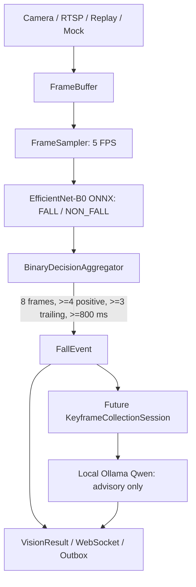

# Post-Fall V2 Current State

Date: 2026-08-14  
Authoritative artifacts: `artifacts/post_fall_v2/finalization/`

## One-line Status

Post-Fall V2 is a verified Binary-First local runtime and replay chain, but `P3_ALLOWED=NO` because no qualified current target-camera dataset or authorized active RTSP is available for calibration and independent acceptance.

## Runtime Contract



- The formal decision owner is EfficientNet-B0 plus `BinaryDecisionAggregator`.
- Qwen describes an already confirmed event. It cannot create, cancel, overturn, or medically diagnose a fall.
- PFV2 does not start legacy detection, pose, temporal/LSTM, fusion, or legacy publisher workers for a camera.
- External event delivery and main-system alerts are disabled in the safe local profile.

## Frozen Baseline

| Item | Value |
| --- | --- |
| Active local mode | `post_fall_v2` |
| Binary model | EfficientNet-B0 ONNX |
| Model SHA256 | `e9871cdb4687055fb5d934dd994c2ad883adac0c2acab375c240f8e005ee04cc` |
| Input policy | `FULL_FRAME_TRAIN_MATCHED` |
| Binary threshold | `0.3979087471961975` |
| Threshold status | OOF engineering baseline, not target-domain calibrated |
| Aggregator | 8 frames / 4 positives / 3 consecutive / 800 ms |
| Recovery / cooldown | 1500 ms / 3000 ms |
| Qwen | `qwen-vision-cn:latest` at local Ollama `/api/chat` |
| Keyframes | `-3s,-1s,0,+1s,+3s,+5s`, 750 ms tolerance |

## Validation Status

| Area | Status | Evidence |
| --- | --- | --- |
| PFV2 focused tests | PASS | 26 final parser/runtime tests; 58 broader PFV2 tests |
| Full test suite | PASS | 738 passed, 2 existing warnings |
| Local Mock runtime | PASS | HTTP status/demo/source/latest frame and WebSocket |
| Replay E2E | PASS | 63 binary results, 1 event, 6 resolved keyframes, Qwen completed |
| Qwen parser robustness | PASS | Markdown, aliases, English enums, missing fields and medical-language handling covered |
| Qwen unavailable/timeout event independence | PASS | Runtime tests retain the binary-confirmed event |
| Target-camera calibration | BLOCKED | 18 calibration recordings absent |
| Target-camera acceptance | BLOCKED | 12 acceptance recordings absent |
| Target RTSP | BLOCKED | Current `.env` has no authorized RTSP URL |

## Qwen Boundaries and Recovery

The local request uses Ollama JSON Schema mode. The response handler extracts the first JSON object from Markdown or surrounding text, normalizes supported field aliases and enum variants, turns unrecoverable descriptive fields into `unknown`, and retains a fully invalid response as `parse_failed`. It performs no model retry. Medical diagnosis terms are replaced by a visual-only human-review statement.

This preserves the Binary-First rule: Qwen failure changes only VLM detail status, never the confirmed `FallEvent`.

## Target-Domain Gate

The frozen 30-session split is present and session-separated:

- Calibration: 18 sessions.
- Acceptance: 12 sessions.
- Split SHA256: `5248aa3181e12e23581df9a39b7bb4a23cd45c673de681f51990067ec3087e3a`.

However, all 30 target-camera recording paths are absent. Existing private replay videos, fixtures and generated clips are explicitly classified as generic replay, test fixtures, or artifacts, not target-camera evidence. Therefore no threshold sweep, calibration freeze, hard-negative metric, or acceptance metric exists.

## P3 Decision

```text
P3_ALLOWED = NO
P3_BLOCKED_BY_EXTERNAL_RESOURCE
```

Required unblock evidence:

1. Authorized current target-camera RTSP or same-camera recordings for all qualified sessions.
2. Calibration-only threshold/aggregator evaluation and frozen parameter record.
3. Independent acceptance metrics, including hard negatives and static post-fall scenarios.
4. Target RTSP stability and latency validation.

## Scenario Boundaries

| Scenario | Current statement |
| --- | --- |
| Normal standing | Logic verified as `NON_FALL -> no event -> no Qwen`; target domain not verified |
| Fast fall and sustained ground state | Generic replay E2E PASS; target domain not verified |
| Slow fall and 5-10 second ground state | State machine supports it if binary stays positive; target domain not verified |
| Startup while already fallen | Supported by architecture; target domain not verified |
| Intentional bed/sofa/floor lying | Target-domain hard-negative risk not verified |
| Bending / squatting | Target-domain hard-negative risk not verified |
| Brief low posture then recovery | Aggregator prevents short positives; target-domain behavior not verified |
| Ten-minute continuous ground state | One incident until recovery/cooldown; automated logic verified |
| Multi-person image | Camera-level fall signal only; individual attribution unsupported |

## Configuration Files

- `.env.example`: safe PFV2 local default with external delivery disabled.
- `configs/safe_demo.env`: safe Mock PFV2 runtime.
- `configs/post_fall_v2_candidate.env`: controlled target-RTSP candidate template, not P3 approval.
- `configs/production_candidate.env`: historical legacy rollback profile, not a PFV2 candidate.
