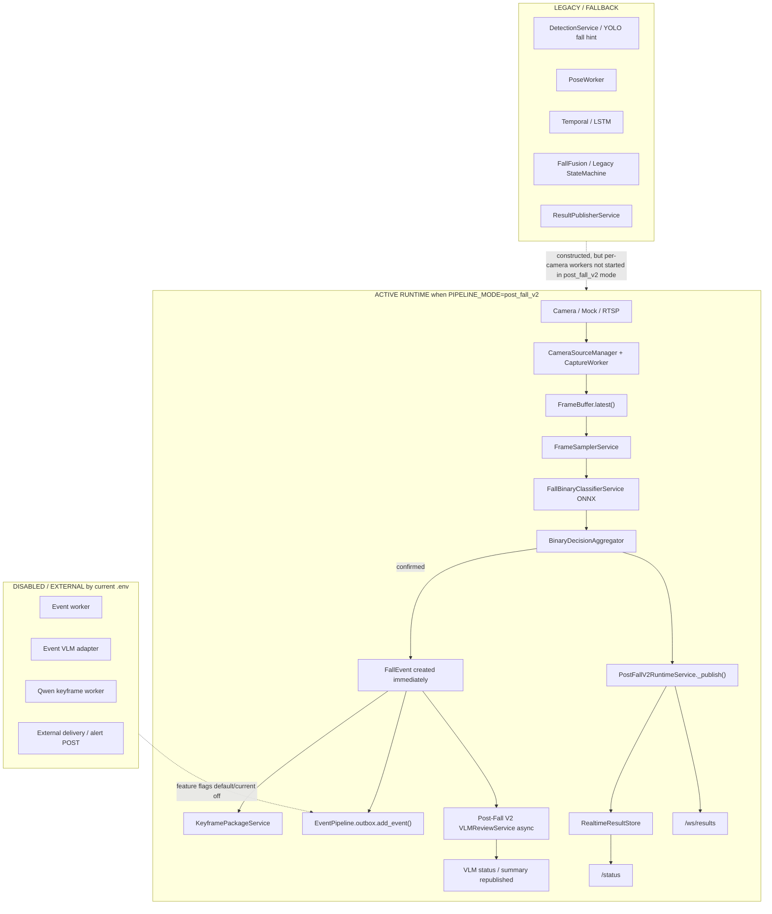

# 《Post-Fall V2 重构后当前项目真实状态审计报告》

审计日期：2026-08-13  
审计范围：`E:\国赛\camera-service`  
审计性质：AUDIT / VERIFY / BASELINE REBUILD，不修改业务逻辑。  

> Historical / superseded on 2026-08-14.  
> 本文关于默认 pipeline、Qwen 注入、未来关键帧与 legacy 资源加载的部分结论已过时；当前事实见 [post_fall_v2_current_state.md](post_fall_v2_current_state.md)。

## 1. Executive Summary

当前项目已经具备一条正式的 Post-Fall V2 Binary-First 工程主链：视频帧进入 `FrameBuffer` 后，在 `PIPELINE_MODE=post_fall_v2` 下由 `PostFallV2RuntimeService` 独立采样、调用 EfficientNet-B0 ONNX 二分类模型、用 `BinaryDecisionAggregator` 做多帧确认，并在确认后立即生成 `FallEvent` 与实时 `VisionResult`。在这个模式下，legacy 的 YOLO fall hint、Pose、Temporal/LSTM、Fusion、Legacy StateMachine 与 ResultPublisher worker 不再拥有最终跌倒判定权，也不会在每摄像头启动链路中被启动。核心单元/集成测试、相关回归、全量 pytest 与安全冒烟均已通过。

但当前默认 `.env` 仍是 `PIPELINE_MODE=legacy`，Post-Fall V2 只是“代码支持并可通过覆盖配置启动”，不是当前默认运行态。更重要的是，Post-Fall V2 runtime 接入的是自己的异步 `VLMReviewService`，默认 analyzer 是 dummy；事件系统中另有 Qwen/Ollama VLM adapter 和 Qwen keyframe worker，但没有被 Post-Fall V2 runtime 默认注入。因此，“二分类先判跌倒，再触发异步 VLM 细判”的工程接口已成立；“已经真实接入本地千问并完成生产级跌倒后详细分析”只能判为 PARTIAL。目标摄像头域数据、阈值迁移和真实 RTSP 验收仍为 BLOCKED / NOT_RUN。

## 2. 当前一句话状态

Post-Fall V2 Binary-First 工程主链已实现并通过自动化验证，但当前默认配置仍运行 legacy，且真实 Qwen/VLM 绑定与目标摄像头生产验证尚未完成。

## 3. 当前真实 Runtime 架构



重要区别：`app/main.py` 会构造 legacy 服务对象，安全冒烟中甚至加载了 YOLO 权重；但 `app/services/stream_service.py` 的 `post_fall_v2` 分支只启动 `post_fall_v2_runtime_service`，随后直接返回。对象存在不等于 legacy 主链仍有判定权。

## 4. Runtime 调用链

| 阶段 | 文件 / 类 / 函数 | 输入 | 输出 | 审计结论 |
| --- | --- | --- | --- | --- |
| 应用启动 | `app/main.py` / `lifespan` | Settings | 构造 Runtime、各 Service、路由 | PASS；Post-Fall V2 runtime 被构造 |
| 摄像头启动 | `app/services/stream_service.py` / `StreamService.start` | camera_id, source_url | source runtime | PASS；`pipeline_mode == "post_fall_v2"` 时只启动 PFV2 runtime |
| 帧来源 | `CameraSourceManager` / `FrameBuffer.latest()` | 捕获线程最新帧 | `FramePacket` | PASS；二分类从最新帧非消费采样 |
| 采样 | `FrameSamplerService.try_sample` | `FramePacket` | `SampledFrame` | PASS；按 FPS、重复帧、过期帧过滤 |
| 二分类 | `FallBinaryClassifierService.infer` | BGR full frame | `BinaryFallResult` | PASS；ONNX 二分类是第一跌倒判定 AI |
| 聚合 | `BinaryDecisionAggregator.update` | `BinaryFrameResult` | `BinaryAggregateDecision` | PASS；单帧不确认，多帧防抖 |
| 事件 | `PostFallV2RuntimeService._maybe_create_event` | confirmed decision | `FallEvent` | PASS；VLM 前立即创建事件 |
| 关键帧 | `KeyframePackageService.build` | rolling buffer + offsets | `KeyframePackage` | PARTIAL；多关键帧结构存在，但 post offset 当前用最近帧，不等待未来帧到齐 |
| VLM | `VLMReviewService.analyze_fall_event` | `FallEvent` + keyframes | `FallDetailResult` | PARTIAL；异步细判接口存在，默认 dummy，不是真实 Qwen |
| 发布 | `PostFallV2RuntimeService._publish` | binary + aggregate + event | `VisionResult` | PASS；写入 store 并推送 WS |
| 状态 | `StatusService.status` | runtime snapshot | `/status` | PASS/PARTIAL；能看 runtime 细节，但配置快照未显式显示 `pipeline_mode` |

## 5. Binary 状态

| 项 | 当前真实状态 |
| --- | --- |
| 模型文件 | `models/post_fall_v2/efficientnet_b0/fall_candidate_efficientnet_b0.onnx` |
| 文件大小 | `16030443` bytes |
| SHA256 | `e9871cdb4687055fb5d934dd994c2ad883adac0c2acab375c240f8e005ee04cc` |
| ONNX input | `input`, shape `['batch', 3, 224, 224]`, `tensor(float)` |
| ONNX output | `logits`, shape `['batch', 2]`, `tensor(float)` |
| Provider | `CPUExecutionProvider` |
| 预处理 | BGR -> RGB，按长边缩放/letterbox 到 224，ImageNet mean/std，NCHW float32 |
| 标签语义 | class 0 = `noFall` / NON_FALL；class 1 = `Fall` / FALL |
| 阈值 | `0.3979087471961975` |
| 阈值状态 | OOF / engineering default，`production_validated=False`，不是目标摄像头生产阈值 |
| 输入策略 | `FULL_FRAME_TRAIN_MATCHED` |

注意：这里的 `noFall` 不是严格的“站立”语义，而是“非跌倒”二分类负类。演讲时若说“只判断跌倒/站立”，建议改成更准确的“跌倒/非跌倒，其中演示样例用站立代表非跌倒”。

## 6. Aggregator 状态

真实状态机：

```text
NORMAL
-> FALL_CANDIDATE
-> EVENT_ACTIVE
-> RECOVERY_PENDING
-> COOLDOWN
-> NORMAL
```

schema 中存在 `FALL_CONFIRMED` 字面量，但当前实现确认后直接进入 `EVENT_ACTIVE`，对外 `fall_state` 为 `confirmed`。

| 参数 | 当前值 | 来源 | 作用 |
| --- | ---: | --- | --- |
| binary threshold | `0.3979087471961975` | `Settings.post_fall_v2_binary_threshold` | 单帧 FALL 判定阈值 |
| sample_fps | `5` | `POST_FALL_V2_SAMPLE_FPS` 默认 / example | 采样频率 |
| window_size | `8` | `POST_FALL_V2_WINDOW_SIZE` | 滑动窗口最大帧数 |
| min_positive_frames | `4` | `POST_FALL_V2_MIN_POSITIVE_FRAMES` | 窗口内最少阳性数 |
| min_consecutive_frames | `3` | `POST_FALL_V2_MIN_CONSECUTIVE_FRAMES` | 连续阳性帧数 |
| candidate_min_ms | `800` | `POST_FALL_V2_CANDIDATE_MIN_MS` | 候选态最短持续时间 |
| recovery_min_ms | `1500` | `POST_FALL_V2_RECOVERY_MIN_MS` | 恢复确认时间 |
| cooldown_ms | `3000` | `POST_FALL_V2_COOLDOWN_MS` | 事件后冷却时间 |
| event_buffer_seconds | `8` | `POST_FALL_V2_EVENT_BUFFER_SECONDS` | 关键帧缓存窗口 |

自动化测试已验证：单帧 FALL 不创建事件；短暂误判回 NORMAL；持续 FALL 只创建一个事件；恢复、冷却、re-arm 后第二次跌倒会创建新的 incident。

## 7. Event / Keyframe 状态

`PostFallV2RuntimeService._maybe_create_event()` 在 `decision.event_created=True` 时立即创建 `FallEvent`，字段包括：

| 字段 | 状态 |
| --- | --- |
| `incident_id` | `pfv2-{camera_id}-{uuid}` |
| `camera_id` | 来自二分类结果 |
| `state` | `fall_confirmed` |
| `confirmed_at` | 聚合确认时间 |
| `binary_evidence` | 窗口、阳性数、连续阳性数、均值/最大概率、阈值 |
| `keyframes` | 多关键帧包 |
| `vlm_status` | disabled / pending / running / completed / failed / timeout |
| `vlm_analysis` | VLM 完成、失败或超时后的细节 |

关键帧 offsets 来自 `EVENT_KEYFRAME_OFFSETS_MS` 默认值：

```text
-3000, -1000, 0, +1000, +3000, +5000 ms
```

当前 `KeyframePackageService` 会立即从 `RollingEventBuffer` 选取每个 offset 最近的可用帧。它可以给 VLM 多帧输入结构，但对于 `+1000/+3000/+5000` 这类事件后关键帧，当前 Post-Fall V2 runtime 不等待未来帧采集完成，因此这些 offset 可能退化为当前帧或邻近历史帧。这是“演示可用、证据完整性仍需增强”的点。

Post-Fall V2 同时会把 `FallEventRecord` 写入 `event_pipeline.outbox.add_event()`。即使 `EVENT_PIPELINE_ENABLED=false`，outbox 对象仍存在，记录可被加入内存 outbox；但事件 worker、语义分析、归档、delivery 是否处理取决于事件系统开关。

## 8. VLM 状态

| 问题 | 当前真实状态 |
| --- | --- |
| 由谁触发 | `PostFallV2RuntimeService._schedule_vlm()`，只在 `FallEvent` 创建后触发 |
| NON_FALL 是否触发 | 不触发；测试验证 VLM calls = 0 |
| 一个 incident 调几次 | 设计上每个 incident 最多一个 active thread；持续躺地不重复创建事件，也不重复 VLM |
| 输入 | `FallEvent` + `KeyframePackage` 多帧结构 |
| 输出 | `FallDetailResult`：posture、movement、attempt_to_stand、persistent_ground_state、visibility、occlusion、scene_risks、summary 等 |
| 失败策略 | timeout / failed 不删除 FallEvent；只更新 `vlm_status` 与错误摘要 |
| 真实 Qwen 接入 | PARTIAL；Post-Fall V2 默认是 `DummyFallVLMAnalyzer` |

事件系统另有 `EventVLMAdapter`、`QwenHttpVLMReviewAdapter`、`QwenOllamaReviewAdapter`、`QwenKeyframeWorker` 以及相关测试。但这些属于 `app/events/*` 事件语义/Qwen链，当前 Post-Fall V2 runtime 构造 `VLMReviewService` 时没有把这些 adapter 默认注入。因此不能宣称“Post-Fall V2 已经真实调用本地千问完成细判”。更准确表述是：Post-Fall V2 已预留并测试了异步 VLM 细判接口，默认实现是 dummy，真实 Qwen 绑定仍需完成和验收。

## 9. Legacy 状态

| Legacy 模块 | post_fall_v2 模式是否每摄像头运行 | 是否影响 Final Decision | 是否影响 Event | 当前定位 |
| --- | --- | --- | --- | --- |
| DetectionService / YOLO | 不由 `StreamService.start()` 启动；对象可能构造/加载 | 否 | 否 | LEGACY / startup cost |
| YOLO fall hint worker | 不启动 | 否 | 否 | LEGACY |
| Tracking worker | 不启动 | 否 | 否 | LEGACY / fallback |
| Pose worker | 不启动 | 否 | 否 | LEGACY / optional |
| Temporal / LSTM worker | 不启动 | 否 | 否 | LEGACY |
| Fusion worker | 不启动 | 否 | 否 | LEGACY |
| FallFusionService / StateMachine | 不进入 PFV2 主链 | 否 | 否 | LEGACY |
| ResultPublisherService worker | 不启动 | 否；PFV2 自己发布 | 否 | LEGACY publisher |
| FallEventReporterService | app startup 构造；当前 `.env` alert disabled | 否 | 外部告警关闭 | DISABLED external |

`tests/test_post_fall_v2_stream_mode_isolation.py` 明确验证：`post_fall_v2` 模式启动流时，PFV2 runtime 启动，legacy detection 与 publisher 不启动。

## 10. 配置状态

| 配置项 | 当前 `.env` / 默认 | 作用 | 审计结论 |
| --- | --- | --- | --- |
| `PIPELINE_MODE` | `.env = legacy` | 当前默认主链 | 当前默认不是 PFV2 |
| 支持 mode | `legacy`, `async_v1`, `fall_disabled`, `post_fall_v2` | 可切换 pipeline | PASS |
| `POST_FALL_V2_ENABLED` | `.env` 未显式设置；effective false under legacy | 启用 PFV2 runtime | 默认未启用 |
| `POST_FALL_V2_VLM_ENABLED` | example/safe_demo = false；默认 false | 启用 PFV2 VLM | 默认关闭 |
| `POST_FALL_V2_BINARY_THRESHOLD` | `0.3979087471961975` | 二分类阈值 | 工程阈值，非生产验收 |
| `EVENT_PIPELINE_ENABLED` | `.env = false` | 事件 worker 链 | 默认关闭 |
| `EVENT_VLM_ENABLED` | `.env = false` | event 语义 VLM | 默认关闭 |
| `EVENT_QWEN_KEYFRAME_ANALYSIS_ENABLED` | `.env = false` | Qwen keyframe worker | 默认关闭 |
| `EVENT_DELIVERY_ENABLED` | `.env = false` | 外部事件投递 | 默认关闭 |
| `MAIN_SYSTEM_ALERT_ENABLED` | `.env = false` | 主系统报警 POST | 默认关闭 |
| `MOCK_CAMERA_ENABLED` | `.env = true` | 无 RTSP 时 mock stream | safe demo 默认可跑 |

特别说明：`Settings.__post_init__` 会拒绝 `PIPELINE_MODE=post_fall_v2` 但 `POST_FALL_V2_ENABLED=false` 的组合。审计中用进程环境覆盖 `PIPELINE_MODE=post_fall_v2` 与 `POST_FALL_V2_ENABLED=true` 后，配置加载结果为：

```text
post_fall_v2 True FULL_FRAME_TRAIN_MATCHED 0.3979087471961975 False
```

## 11. API / Frontend 状态

实际路由包括：

| 能力 | 路径 |
| --- | --- |
| 健康检查 | `/healthz` |
| 状态 | `/status` |
| WebSocket 结果 | `/ws/results` |
| 最新帧 | `/stream/latest-frame.jpg` |
| 启停流 | `/stream/start`, `/stream/stop` |
| WebRTC | `/webrtc/offer`, `/webrtc/candidate` |
| 事件 API | `/events/status`, `/events/outbox`, `/events/latest`, `/events/{incident_id}` 等 |
| Demo | `/demo` 静态前端 |

前端 `frontend_demo/index.html` / `frontend_demo/app.js` 已有事件级 VLM Advisory、Qwen Keyframe Analysis、incident id、fall probability、fall decision 等展示逻辑。它更偏事件系统/Qwen advisory 展示；对 Post-Fall V2 runtime 发布的 `fall_decision.vlm_summary` 可通过实时结果拿到，但是否有完整 PFV2 专区需要进一步 UI 验收。

## 12. 测试与验证结果

| 验证项 | 命令/范围 | 结果 |
| --- | --- | --- |
| 核心 PFV2 测试 | aggregator + runtime + stream isolation + pipeline config | `14 passed in 2.78s` |
| 相关回归 | PFV2、model、publisher、event、VLM adapter、Qwen acceptance、status | `85 passed, 1 warning in 3.62s` |
| 语法编译 | `compileall app/post_fall_v2 app/core app/services app/api app/camera scripts tools/fall_hint_labeler -q` | PASS，无输出 |
| 全量 pytest | `python -m pytest -q` | `717 passed, 2 warnings in 28.10s` |
| ONNX 合同 | SHA + session metadata | PASS |
| 安全冒烟 | TestClient + mock + PFV2 env override | PASS；status 200，runtime running，binary loaded，frames processed |

全量 pytest warnings：

```text
StarletteDeprecationWarning: fastapi TestClient uses httpx; install httpx2 instead.
PytestReturnNotNoneWarning: tests/test_evaluate_fall_lstm_metrics.py::test_schema returned dict.
```

安全冒烟关键输出：

```text
status_code 200
post_fall_v2_runtime:
enabled=true
running=true
binary_model_loaded=true
frames_processed=7
binary_last_probability=0.44843968749046326
vlm_enabled=false
event_count=1
last_error=null
```

解释：mock/colorbars 下产生 `event_count=1` 只证明链路能启动、推理、聚合并创建事件；不能作为真实摄像头准确率或生产阈值证据。

Git 基线：`E:\国赛\camera-service` 当前不是 Git repository，`git status`、`git branch`、`git log`、`git diff --stat` 均不可用。因此无法确认 branch、commit、diff 或 untracked 状态，本报告不使用 Git 历史作为证据。

## 13. 核心场景验收矩阵

| 场景 | Result | 证据 |
| --- | --- | --- |
| 持续正常 / NON_FALL | PASS in synthetic tests | runtime test：无 event，VLM calls = 0 |
| 单帧 FALL | PASS | aggregator test：进入 `FALL_CANDIDATE`，不创建 event |
| 短暂误判 | PASS | aggregator test：回到 `NORMAL` |
| 连续 FALL | PASS | aggregator/runtime test：创建一个 incident |
| Fall 后躺地 5~10s | PASS in synthetic state-machine | aggregator test：持续 FALL 不重复 event |
| Recovery | PASS | aggregator test：进入 recovery/cooldown |
| 第二次 Fall | PASS | aggregator test：re-arm 后新 incident |
| NON_FALL -> VLM | PASS | runtime test：VLM calls = 0 |
| VLM timeout | PASS | runtime test：事件保留，`vlm_status=timeout` |
| VLM failed/offline | PASS for exception path | runtime test：事件保留，`vlm_status=failed` |
| Legacy isolation | PASS | stream isolation test |
| 真实目标摄像头 replay | NOT_RUN / BLOCKED | `docs/post_fall_v2_current_camera_domain_evidence_report.md` |
| 真实本地 Qwen 接入 PFV2 | PARTIAL / NOT_VERIFIED | PFV2 默认 dummy；event Qwen adapter 未注入 PFV2 runtime |

## 14. 目标摄像头状态

依据 `docs/post_fall_v2_current_camera_domain_evidence_report.md`：

| Gate | 状态 |
| --- | --- |
| DATA | BLOCKED：无确认的当前官方养老目标摄像头 RTSP 或同摄像头 replay |
| CALIBRATION | NOT_RUN |
| THRESHOLD TRANSFER | NOT_RUN |
| ACCEPTANCE | NOT_RUN |
| REAL RTSP | NOT_RUN |
| `P3_ALLOWED` | NO |

现有 mock、fixture、私有 acceptance、下载/生成/历史训练视频均不能算当前目标摄像头域证据。

## 15. 工程完成度与生产完成度

| 维度 | 估计 | 解释 |
| --- | ---: | --- |
| ENGINEERING IMPLEMENTATION | 85% | Binary-First runtime、聚合、事件、发布、VLM 接口、测试基本完成；真实 Qwen 注入和 keyframe post-frame 等待仍缺 |
| PRODUCTION VALIDATION | 35% | 全量测试通过，但目标摄像头数据、阈值迁移、真实 RTSP、真实 Qwen、告警闭环均未完成验收 |

这个百分比不是产品承诺，只是用于后续排期优先级判断。

## 16. 当前问题清单

| 优先级 | 问题 | 影响 |
| --- | --- | --- |
| P1 | Post-Fall V2 VLM 默认是 dummy，未默认接入真实 Qwen/Ollama adapter | 不能宣称“已由千问完成跌倒后详细分析” |
| P1 | 目标摄像头域数据与阈值验收 BLOCKED | 不能宣称生产可用或阈值已验证 |
| P2 | 当前 `.env` 仍是 `PIPELINE_MODE=legacy` | PFV2 不是默认运行态，演示需显式切换 |
| P2 | PFV2 keyframe post offsets 不等待未来帧 | VLM 可能拿不到真实 t+1/t+3/t+5 事件后证据 |
| P2 | 安全冒烟中 DetectionService 对象加载 YOLO 权重 | 不影响 PFV2 判定权，但有启动耗时/资源成本 |
| P3 | `/status.configuration` 安全快照未显式显示 `pipeline_mode` | 运维可观测性略不足 |
| P3 | 非 Git 仓库，无法建立提交级基线 | 接管审计缺少 commit/diff 证据 |

## 17. 技术债

| 类别 | 内容 |
| --- | --- |
| Legacy 保留 | detection/pose/temporal/fusion 仍大量存在，回滚有价值，但接管复杂 |
| 双 VLM 体系 | PFV2 的 `VLMReviewService` 与 event 系统的 Qwen/VLM adapter 分离 |
| 配置分散 | PFV2 VLM、event VLM、Qwen keyframe、delivery 多套开关并存 |
| 证据完整性 | PFV2 keyframes 不做事件后延迟收集 |
| 测试缺口 | 缺少真实目标摄像头 replay / RTSP 验收 |
| 版本基线 | 无 Git 元信息，难以追踪工程变更 |

## 18. 下一步建议

主任务：把真实 Qwen/Ollama analyzer 明确接入 Post-Fall V2 `VLMReviewService`，并做一次受控 replay/RTSP E2E 验收。

次级任务：

1. 采集当前官方目标摄像头数据，完成 calibration / acceptance split 与阈值迁移报告。
2. 为 PFV2 keyframe 增加事件后延迟补帧或复用 event pipeline 的 post-keyframe collection。
3. 在 `/status.configuration` 中加入安全的 `pipeline_mode` 字段，便于演示和运维确认当前主链。

## 19. 六项核心结论

【当前真正运行的跌倒检测主链】  
在 `PIPELINE_MODE=post_fall_v2` 且 `POST_FALL_V2_ENABLED=true` 下：Camera/Capture -> FrameBuffer -> FrameSampler -> EfficientNet-B0 binary classifier -> BinaryDecisionAggregator -> FallEvent -> async VLMReviewService -> RealtimeResultStore/WebSocket/Event outbox。

【二分类是否已经成为正式第一判定层】  
PASS。Post-Fall V2 模式下，二分类模型是第一也是唯一的正式跌倒判定 AI。

【Legacy 是否已经失去 Post-Fall V2 最终判定权】  
PASS。legacy 服务对象仍构造，部分模型可能加载，但每摄像头 PFV2 主链不会启动 legacy detection/pose/temporal/fusion/publisher worker。

【Fall 是否已经能够自动进入 VLM 详细分析】  
PARTIAL。FallEvent 后会自动进入 PFV2 异步 VLMReviewService；但默认 analyzer 是 dummy，不是真实 Qwen。

【持续倒地 5~10 秒是否只产生一个事件】  
PASS in synthetic tests；真实摄像头场景 NOT_RUN。状态机测试验证持续 FALL 不重复创建事件。

【当前距离真正生产可用还差什么】  
真实 Qwen 接入 PFV2、目标摄像头数据与阈值迁移、真实 RTSP/replay 验收、事件后关键帧完整性、生产告警闭环验收。

## 20. 最终回答

问题：现在这个系统，是否真的已经变成“视频流进入 -> 二分类判断跌倒/非跌倒 -> 确认跌倒 -> 千问大模型详细分析”？

结论：PARTIALLY。

原因：视频流进入后由二分类优先判定、再经多帧确认生成 FallEvent 的主链已经实现并通过测试；确认后也会进入异步 VLMReviewService。但当前 Post-Fall V2 默认 VLM 是 dummy analyzer，真实本地千问/Qwen adapter 尚未默认接入并完成目标摄像头验收。
