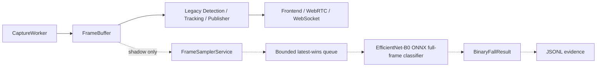

# Post-Fall V2 Shadow Binary Adapter Report

Stage: `P2_SHADOW_FRAME_AND_BINARY_ADAPTER`

Date: 2026-08-10

Scope: shadow-only binary classifier adapter and evidence recording. This stage
does not replace the legacy fall chain and does not create fall incidents,
alerts, VLM reviews, or external delivery.

Final gate:

`POST_FALL_V2_SHADOW_BINARY_ADAPTER_READY`

Domain gate remains:

`POST_FALL_V2_BINARY_DOMAIN_VALIDATION_BLOCKED`

## 1. Executive Summary

P2 is complete as a shadow/offline adapter.

Implemented chain:

```text
FrameBuffer
-> FrameSamplerService
-> bounded latest-wins queue
-> FallBinaryClassifierService
-> BinaryFallResult
-> FallShadowEvidenceService JSONL
```

The adapter is additive and default-off:

`POST_FALL_V2_SHADOW_ENABLED=false`

## 2. Modified Files

Added:

- `app/post_fall_v2/__init__.py`
- `app/post_fall_v2/schemas.py`
- `app/post_fall_v2/frame_sampler_service.py`
- `app/post_fall_v2/fall_binary_classifier_service.py`
- `app/post_fall_v2/fall_shadow_evidence_service.py`
- `app/post_fall_v2/fall_binary_shadow_service.py`
- `tools/run_post_fall_v2_shadow_replay.py`
- `tests/test_post_fall_v2_shadow_binary_adapter.py`
- `docs/post_fall_v2_shadow_binary_adapter_report.md`

Modified:

- `app/core/config.py`
- `app/core/runtime.py`
- `app/main.py`
- `app/services/stream_service.py`
- `app/services/status_service.py`
- `requirements.txt`
- `.env.example`

Not modified:

- `.env`
- legacy detector implementations
- VLM/event delivery/main-system POST code paths

## 3. Shadow Architecture



The shadow service reads `FrameBuffer.latest()` non-consumingly. It does not
write to `RealtimeResultStore` and does not alter `VisionResult`.

## 4. FrameSampler Design

`FrameSamplerService` uses monotonic time and `sample_fps`, not `frame_index % N`.

It prevents:

- duplicate frame sampling by `FramePacket.seq`
- stale frame sampling by max frame age
- over-sampling inside the configured interval

Output schema: `SampledFrame`.

## 5. Queue / Backpressure Policy

Runtime shadow uses a bounded queue:

`POST_FALL_V2_SHADOW_QUEUE_SIZE=2`

Policy:

`latest-wins`

If inference falls behind sampling, older shadow frames are dropped. Capture,
FrameBuffer, DetectionService, WebRTC, and WebSocket are never blocked waiting
for EfficientNet inference.

Queue test result:

- max queue size: `2`
- submitted frames: `4`
- retained frame seqs: `[3, 4]`
- dropped frames: `2`

## 6. Classifier Adapter

`FallBinaryClassifierService` loads:

`models/post_fall_v2/efficientnet_b0/fall_candidate_efficientnet_b0.onnx`

Startup checks:

- model file exists
- SHA256 matches expected value
- ONNX Runtime provider is available
- input name is `input`
- output name is `logits`

Verified SHA256:

`e9871cdb4687055fb5d934dd994c2ad883adac0c2acab375c240f8e005ee04cc`

Observed provider in this run:

`CPUExecutionProvider`

## 7. Input Policy

Baseline policy:

`FULL_FRAME_TRAIN_MATCHED`

Preprocessing:

```text
BGR camera frame
-> RGB
-> LongestMaxSize(224)
-> center reflect padding to 224x224
-> ImageNet Normalize
-> float32 NCHW
```

No person crop, YOLO letterbox, center crop, CLAHE, sharpening, or extra
normalization is used.

`EXPERIMENTAL_PERSON_ROI` is only reserved as a named future policy and is not
accepted as the P2 shadow baseline.

## 8. BinaryFallResult Schema

The schema includes:

- `frame_id`, `camera_id`
- `captured_at`, `sampled_at`, `inferred_at`
- `prediction`, `class_index`
- `fall_probability`, `nofall_probability`
- `shadow_candidate_hint`
- threshold provenance and production validation flag
- model identity and SHA256
- input policy and source/model dimensions
- `queue_delay_ms`, `preprocess_ms`, `inference_ms`, `total_ms`
- `valid`, `error_code`, `error_message`
- `human_label`, `scenario_label`
- `analysis_only`

Forbidden names such as `fall_detected`, `fall_confirmed`, and `alarm` were not
introduced.

## 9. Threshold Provenance

Threshold:

`0.3979087471961975`

Type:

`BINARY_CANDIDATE_THRESHOLD_OOF`

Production validated:

`false`

The threshold only controls `shadow_candidate_hint`.

## 10. Evidence Recorder

`FallShadowEvidenceService` writes JSONL to:

`artifacts/post_fall_v2/shadow`

Configurable controls:

- metadata write on/off
- frame saving on/off
- frame-save probability threshold
- max saved frames per minute

Default:

- save metadata: true
- save frames: false

## 11. Offline Replay

Tool:

`tools/run_post_fall_v2_shadow_replay.py`

Supported input:

- image
- image directory
- video file

It reuses the same classifier service and preprocessing path as Runtime Shadow.

Actual offline acceptance run:

- Fall sample processed: `1`, shadow candidate hints: `1`
- noFall sample processed: `1`, shadow candidate hints: `0`
- provider: `CPUExecutionProvider`
- output: `artifacts/post_fall_v2/shadow_p2_acceptance/shadow_p2_acceptance.jsonl`

Observed probabilities:

- Fall sample: `0.9999138116836548`
- noFall sample: `0.012657254002988338`

## 12. Runtime Shadow

Runtime integration is present but default-off.

Integration points:

- `Runtime.post_fall_v2_shadow_service`
- `StreamService.start_for_camera(...)` starts shadow only after legacy workers
- `StreamService.stop_for_camera(...)` stops shadow independently
- `StatusService` exposes additive diagnostics under `workers.post_fall_v2_shadow`

Short runtime-shadow smoke with real worker and real ONNX:

- enabled: `true`
- running: `true`
- state: `healthy`
- model_loaded: `true`
- model_hash_verified: `true`
- provider: `CPUExecutionProvider`
- sample_fps: `2.0`
- frames_sampled: `3`
- frames_processed: `3`
- frames_dropped: `0`
- records_written: `3`
- last_inference_ms: `16.0`
- last_error: `null`

## 13. Failure Isolation

Handled as non-fatal:

- missing model
- SHA256 mismatch
- ONNX Runtime unavailable
- bad frame shape
- inference exception
- evidence writer error

If model loading fails while shadow is enabled:

`shadow state = unavailable`

Legacy startup and stream behavior continue.

If one frame fails:

`BinaryFallResult.valid=false`

The worker continues to the next frame.

## 14. Performance Evidence

Offline acceptance on two 1920x1080 images:

| Sample | preprocess_ms | inference_ms | total_ms |
| --- | ---: | ---: | ---: |
| Fall | `31.0` | `16.0` | `47.0` |
| noFall | `16.0` | `47.0` | `63.0` |

Runtime-shadow smoke:

- `last_inference_ms=16.0`
- `last_total_ms=16.0`
- `queue_depth=0`

No CUDA provider was claimed.

## 15. Tests

Executed with project `.venv`:

```text
.\.venv\Scripts\python.exe -m pytest tests\test_safe_configuration.py tests\test_pipeline_mode_config.py tests\test_stream_service_single_source.py tests\test_post_fall_v2_shadow_binary_adapter.py -q
```

Result:

`13 passed, 2 skipped`

The skipped tests are the real ONNX inference tests because `.venv` did not
have `onnxruntime` installed at run time.

Executed with system Python, which has ONNX Runtime:

```text
python -m pytest tests\test_post_fall_v2_shadow_binary_adapter.py -q
```

Result:

`6 passed`

Syntax compile:

`py_compile` passed for all new P2 modules and the replay tool.

## 16. Legacy Regression

Default config check:

- `POST_FALL_V2_SHADOW_ENABLED=false`
- `POST_FALL_V2_INPUT_POLICY=FULL_FRAME_TRAIN_MATCHED`

Relevant regression tests:

- safe configuration
- pipeline mode config
- stream service single source behavior
- P2 shadow adapter tests

Result:

`13 passed, 2 skipped` in `.venv`

`.env` was not modified.

## 17. Known Risks

- `.venv` needs dependency installation from updated `requirements.txt` before
  it can run ONNX shadow inference.
- P2 does not validate production domain fit.
- P2 does not implement temporal aggregation or candidate confirmation.
- Synthetic/random runtime-smoke frames are not domain evidence.
- JSONL can grow over long runs; frame saving remains default-off and capped.

## 18. Domain Validation Status

Still blocked:

`POST_FALL_V2_BINARY_DOMAIN_VALIDATION_BLOCKED`

Reason: current elderly-care camera domain has not yet been collected, labeled,
or threshold-analyzed.

## 19. Gate

P2 gate:

`POST_FALL_V2_SHADOW_BINARY_ADAPTER_READY`

Evidence:

- `MODEL_HASH_VERIFIED`
- `PREPROCESS_MATCHED`
- `FULL_FRAME_POLICY_VERIFIED`
- `OFFLINE_INFERENCE_PASS`
- `BINARY_RESULT_SCHEMA_READY`
- `BOUNDED_SHADOW_QUEUE_PASS`
- `SHADOW_FAILURE_ISOLATION_PASS`
- `EVIDENCE_RECORDING_PASS`
- `LEGACY_BEHAVIOR_UNCHANGED`
- `EXTERNAL_DELIVERY_OFF`

Domain gate:

`POST_FALL_V2_BINARY_DOMAIN_VALIDATION_BLOCKED`

## 20. Next Allowed Stage

Recommended next stage:

`P2.5_CURRENT_CAMERA_DOMAIN_EVIDENCE_COLLECTION`

Allowed:

- enable shadow intentionally in a controlled runtime configuration
- collect current camera probability distributions
- label `human_label` and `scenario_label`
- focus on hard negatives such as bed/sofa/floor-normal lying

Still not allowed:

- VLM/Qwen
- FallCandidateService
- incidents
- alerts
- main-system POST
- production threshold tuning
- legacy replacement
