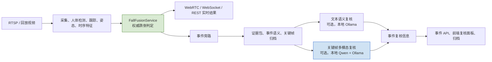

# 千问语义模型在 Vision Service 中的作用与运行指南

日期：2026-07-20  
状态：代码已接入，默认关闭；关键帧多模态链路为 `CODE_READY_NOT_RUNTIME_VERIFIED`  
适用范围：Vision Service 的事件级语义旁路，不适用于机器人控制、医疗诊断或实时跌倒判定。

## 1. 文档目的

本系统新增的千问能力并不是一个新的实时跌倒检测器，也不替代现有 YOLO、姿态估计、时序模型或融合状态机。它的职责是：在规则链路已经形成事件后，对结构化事件信息或已归档的关键帧进行补充解释，为值班人员的复核、事件归档和后续误报分析提供可读的语义说明。

系统必须始终遵守以下边界：

- `FallFusionService` 是跌倒状态和风险等级的唯一权威来源。
- 千问的输出为 `advisory`，即建议性信息；不得修改 `fallen_candidate`、`fallen_confirmed`、风险等级、事件投递状态或主系统告警。
- 千问失败、超时、无可用关键帧或输出不合规时，原有告警与实时视频链路仍正常运行。
- 千问不做身份识别、人员画像、医疗诊断或机器人调度决策。

## 2. 在整体架构中的位置



千问位于事件旁路中。实时采集、推理、发布、WebRTC、WebSocket 和 REST 请求线程不等待千问返回。关键帧分析由单独的单并发后台工作器执行，避免大模型推理拖慢实时画面和规则判定。

## 3. 两条千问接入路径

系统内的“千问语义模型”实际包含两条彼此独立的可选能力，必须按用途区分。

| 能力 | 入口配置 | 输入 | 作用 | 是否包含图像 | 默认状态 |
| --- | --- | --- | --- | --- | --- |
| 文本语义顾问复核 | `EVENT_VLM_ENABLED=true` 且 `EVENT_VLM_PROVIDER=qwen_ollama` | 已脱敏的 `EventSemantics`、证据统计和规则结果 | 对现有事件语义作建议性解读，如提示不确定性、日常活动可能性和人工复核方向 | 否 | 关闭 |
| 千问关键帧多模态复核 | `EVENT_QWEN_KEYFRAME_ANALYSIS_ENABLED=true` | 已归档事件关键帧的字节、最小化事件上下文 | 描述可见姿态、动作、场景、可能误报因素和复核建议 | 是，仅本机 Ollama | 关闭 |

文本路径是结构化数据复核，模型不能声称“看到了画面”。关键帧路径才会向本地视觉模型传入图像字节，因此受到更严格的本地端点和隐私双重门禁。

## 4. 事件处理流程

### 4.1 权威事件先产生

1. 实时视觉主链路输出检测、跟踪、姿态、时序和融合结果。
2. `FallFusionService` 根据已有证据产生 `fallen_candidate` 或 `fallen_confirmed`。
3. 事件管线创建或更新同一 `incident_id` 的事件记录，构建证据包与 `EventSemantics`。
4. 事件归档写入证据 JSON、可用关键帧和时间线信息。

千问不会参与上述四步的阈值比较、状态迁移或告警确认。

### 4.2 文本语义顾问复核

文本路径将事件中的 actor、scene、motion、posture、evidence、risk、uncertainty 和 degradation 状态整理为受限 JSON。其主要价值是将规则和多模块信号转写为一致的复核语言，例如：

- 当前事件为何需要人工注意；
- 坐下、下蹲、弯腰、正常躺卧等日常活动是否仍有可能；
- 哪些证据不足，不能据此作出更强结论；
- 建议操作员查看实时画面、联系现场人员或继续观察。

该路径明确禁止图片、图片编码、文件路径、RTSP 地址、事件标识、相机标识、轨迹标识、人员标识、令牌和投递凭据进入请求载荷。

### 4.3 关键帧多模态复核

关键帧路径默认只在 `fallen_confirmed` 事件归档完成后调度。若显式开启 `EVENT_QWEN_KEYFRAME_ANALYZE_CANDIDATES=true`，才允许分析候选事件。

默认关键帧偏移为：`T-3s`、`T-1s`、`T0`、`T+1s`、`T+3s`、`T+5s`。若启用后置关键帧收集，工作器会等待收集窗口结束，以优先使用事件后的可用画面。缺失帧会写为 `missing_reasons`，不会用伪造画面补齐。

处理步骤如下：

1. `EventArchive` 从事件自己的归档目录读取关键帧文件，并只向分析器提供图像字节、时间偏移和帧角色。
2. `QwenKeyframeWorker` 将同一事件标记为 `pending`，再以单并发线程执行分析。
3. `QwenKeyframeAnalyzer` 将图像以 Base64 传给本机 Ollama `/api/chat` 的 `messages[].images` 字段，并附带最小化上下文：跌倒状态、风险等级和关键帧槽位。
4. 模型必须返回受 JSON Schema 约束的中文建议对象。
5. 通过校验后，工作器将结果写入 outbox，并存为事件归档中的 `qwen_advisory.json`。
6. 事件 API 返回脱敏后的 `qwen_advisory`；前端复核面板展示其状态、场景摘要、姿态/动作、建议和不确定性。

## 5. 输入、输出与模型职责

### 5.1 关键帧输入最小化原则

发送给本地千问视觉模型的请求不包含下列信息：

- `incident_id`、`camera_id`、`track_id`、人员姓名、身份 ID；
- 图像路径、归档路径、快照 URL、RTSP URL、API URL；
- token、authorization、请求原文和其他凭据；
- 原始模型响应、主系统投递地址或投递状态。

图像数据仅以归档文件读取后的内存字节存在于请求中。模型端点必须为 `localhost`、`127.0.0.1` 或 `::1` 上的 HTTP Ollama 服务；非本地端点会被启动安全检查拒绝。

### 5.2 关键帧建议输出

关键帧模型输出 Schema 为 `qwen_keyframe_advisory.v1`，主要字段如下：

| 字段 | 含义 |
| --- | --- |
| `analysis_status` | `disabled`、`pending`、`processing`、`completed`、`degraded` 或 `failed` |
| `scene_summary` | 对可见场景的简短中文描述 |
| `posture_description` | 可见姿态描述，不可推断身份或诊断 |
| `movement_description` | 多帧可观察到的动作或静止情况 |
| `possible_false_positive_reasons` | 可能导致误报的视觉因素，如遮挡或低姿态日常活动 |
| `care_advice` | 面向人工复核的操作建议，不是医疗建议 |
| `confidence_explanation` | 建议结论的证据不足或可信度说明 |
| `advisory_confidence` | `low`、`medium`、`high` 或 `unknown` |
| `image_count`、`analyzed_offsets_ms`、`latency_ms` | 可审计的处理元信息 |
| `missing_reasons`、`error_code` | 降级或失败原因 |

输出不能含有路径、URL、RTSP、凭据、任何标识 ID、原始模型响应或未经允许的额外字段。所有自然语言字段必须是简体中文；含英文描述、无效 JSON、URL 或路径的输出会被拒绝并降级。

### 5.3 千问不负责的事项

千问结果不能：

- 将候选事件改成确认跌倒，或撤销确认跌倒；
- 改写 `risk_level`、`fall_state`、投递状态和 `FallFusionService` 的决策；
- 发起主系统 POST、机器人指令、紧急呼叫或医疗诊断；
- 识别、推断或记录人员身份、年龄、疾病、房间位置等敏感信息；
- 将单张关键帧当作跌倒已经发生的证据。

## 6. 配置与启动门禁

### 6.1 默认配置

`.env.example`、`safe_demo.env`、`production_candidate.env` 和 `dev_experiment.env` 中相关开关均为关闭状态。默认运行时不会创建千问客户端，也不会向任何模型端点发送请求。

关键帧多模态旁路的主要配置如下：

```text
EVENT_QWEN_KEYFRAME_ANALYSIS_ENABLED=false
EVENT_QWEN_KEYFRAME_ANALYZE_CANDIDATES=false
EVENT_QWEN_KEYFRAME_ENDPOINT=http://127.0.0.1:11434/api/chat
EVENT_QWEN_KEYFRAME_MODEL=qwen-vision-cn:latest
EVENT_QWEN_KEYFRAME_TIMEOUT_SECONDS=90
EVENT_QWEN_KEYFRAME_MAX_IMAGES=6
EVENT_QWEN_KEYFRAME_MAX_IMAGE_BYTES=5242880
QWEN_MEDIA_INPUT_ENABLED=false
QWEN_MEDIA_PRIVACY_APPROVED=false
```

文本语义路径的主要配置如下：

```text
EVENT_VLM_ENABLED=false
EVENT_VLM_PROVIDER=qwen_ollama
EVENT_VLM_OLLAMA_ENDPOINT=http://127.0.0.1:11434/api/chat
EVENT_VLM_OLLAMA_MODEL=qwen-vision-cn:latest
EVENT_VLM_OLLAMA_TIMEOUT_SECONDS=15
EVENT_VLM_OLLAMA_TEXT_ONLY=true
EVENT_VLM_OLLAMA_INCLUDE_IMAGES=false
```

### 6.2 关键帧路径的硬性前置条件

启动安全校验会拒绝不满足以下任意条件的配置：

1. `QWEN_MEDIA_INPUT_ENABLED=true` 与 `QWEN_MEDIA_PRIVACY_APPROVED=true` 必须同时存在。
2. `EVENT_PIPELINE_ENABLED=true`、`EVENT_ARCHIVE_ENABLED=true`、`EVENT_ARCHIVE_SAVE_KEYFRAMES=true`、`EVENT_ARCHIVE_SAVE_JSON=true` 必须同时开启。
3. `EVENT_QWEN_KEYFRAME_ENDPOINT` 必须为本机 HTTP Ollama 地址。
4. 模型名不能为空，图片数量必须介于 1 至 6，单图限制不得小于 1 KiB。
5. 本地安装的模型必须实际支持 Ollama 图像消息；文本模型不能伪装为视觉模型使用。

建议先采用会话级环境变量做授权验证，不直接修改长期 `.env`。验证期间应保持 `EVENT_DELIVERY_ENABLED=false`、`EVENT_VLM_ENABLED=false` 与 `MAIN_SYSTEM_ALERT_ENABLED=false`，确保不会产生主系统投递或混淆两条语义路径。

## 7. 状态、降级与恢复

| 状态 | 触发条件 | 对主链路影响 |
| --- | --- | --- |
| `disabled` | 功能未启用 | 无调用、无影响 |
| `pending` | 事件已归档并进入工作队列 | 无影响 |
| `processing` | 后台工作器正在读取归档或调用本地 Ollama | 无影响 |
| `completed` | 返回 JSON 与隐私校验均通过 | 仅新增复核信息 |
| `degraded` | 无可用关键帧、超时、不可用、JSON 不合法或中文校验失败 | 原规则结果继续有效 |
| `failed` | 非预期工作器异常 | 原规则结果继续有效 |

常见 `error_code` 包括 `no_archived_keyframes`、`qwen_timeout`、`qwen_invalid_json`、`qwen_non_chinese_output`、`qwen_unavailable` 与 `qwen_worker_failed`。这些错误不触发事件重判、不触发主系统投递重试，也不会阻塞后续实时帧处理。

服务重启后，对处于 `pending` 或 `processing` 的千问任务会按 outbox 记录重新调度；同一 `incident_id` 的已完成或正在执行任务不会被重复并发分析。

## 8. 对外接口与前端展示

事件接口沿用 `/events` 路由：

```text
GET /events/status
GET /events/outbox
GET /events/latest?camera_id=<camera_id>
GET /events/{incident_id}
```

`GET /events/status` 会给出 `qwen_keyframe_analysis_enabled` 与 `qwen_keyframe_worker` 状态。事件详情、最新事件和 outbox 项可包含 `qwen_advisory` 对象，但 API 的脱敏层会过滤归档路径、原始响应、令牌、请求载荷和其他敏感元数据。

前端事件复核区域只展示建议状态、场景摘要、姿态/动作描述、复核建议和不确定性。它不会把千问结果渲染成“最终告警结论”，也不会将其与规则风险等级混写。

## 9. 隐私、存储与保留策略

1. 关键帧文件仍由现有事件归档策略控制，默认归档根目录为 `logs/event_archive`，默认保留 30 天、每个相机最多 200 个事件。
2. `qwen_advisory.json` 存在于事件归档目录，仅保存经过 Schema 校验的结构化建议；不保存请求载荷或原始 Ollama 文本。
3. 是否允许图像进入本地模型是独立于“是否归档关键帧”的显式授权事项，必须由部署方完成隐私审批。
4. 本实现只允许本机 Ollama，禁止外部模型端点，降低事件画面离开本机的风险。
5. 归档路径不可通过事件 API 暴露；是否开放关键帧文件仍受 `EVENT_KEYFRAME_SERVING_ENABLED` 的独立配置约束。

## 10. 验证证据与当前限制

已覆盖的自动化验证包括：

- 确认跌倒事件可发送归档关键帧字节并保存结构化建议；
- 候选事件默认不发送图片，升级为确认事件后才可调度；
- 非本地端点被启动门禁拒绝；
- 无效 JSON、URL/路径污染和非中文自然语言输出会降级；
- 公开 API 返回建议对象但不泄露归档目录；
- 千问失败不改变 `trusted_result.final_event_type`。

关键帧多模态功能当前仍是 `CODE_READY_NOT_RUNTIME_VERIFIED`：已通过注入传输的自动化测试和单张合成几何图的本地 smoke，但尚未完成真实摄像头或已授权回放事件的端到端验收。因此不得宣称其已经在真实居家场景中验证有效，也不得将其作为生产告警准确率的证据。

## 11. 推荐验收步骤

在获得本地媒体处理批准后，使用合成素材或已授权回放执行一次受控验收：

1. 确认本机 Ollama 可用，并确认指定千问模型能接受图片消息。
2. 仅为当前会话开启事件管线、归档、关键帧保存和千问双重隐私开关。
3. 保持主系统投递、外部 VLM 和真实告警 POST 关闭。
4. 触发一条 `fallen_confirmed` 事件，检查关键帧数、偏移、耗时、`analysis_status`、`error_code` 和 `qwen_advisory.json`。
5. 通过 `/events/{incident_id}` 验证 API 只返回建议字段且不暴露路径。
6. 同时观察 WebRTC、WebSocket、REST 状态和 `FallFusionService`，确认千问调用前后主链路连续。
7. 记录素材类型为“合成”“已授权回放”或“真实摄像头”，不得混用验收结论。

## 12. 相关实现与测试

- `app/events/qwen_keyframe.py`：本地端点限制、图像载荷、JSON Schema 和输出净化。
- `app/events/qwen_keyframe_worker.py`：单并发异步工作器与错误映射。
- `app/events/pipeline.py`：归档后调度、候选事件门禁和任务恢复。
- `app/events/archive.py`：归档关键帧读取与 `qwen_advisory.json` 写入。
- `app/events/vlm_adapter.py`：文本语义顾问复核适配器。
- `app/events/vlm_prompt.py`：文本与多模态顾问提示词约束。
- `app/core/config.py`：配置解析和启动安全门禁。
- `app/api/event_api.py`：状态与事件详情的脱敏公开接口。
- `tests/test_qwen_keyframe_multimodal.py`：关键帧旁路的核心契约测试。

专项实现与最初验证记录见 `docs/qwen_keyframe_multimodal_pipeline_20260719.md`。本文件用于解释系统职责、部署边界和后续验收口径。
