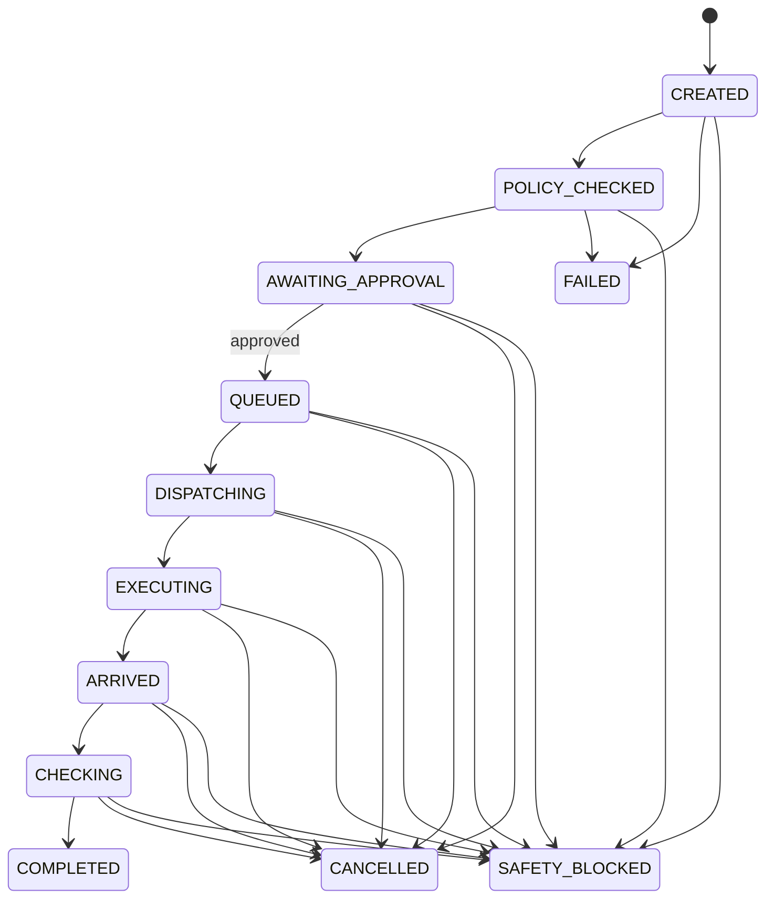

# RobotAssistTask 状态机 V1

`FAILED`、`CANCELLED`、`TIMED_OUT`、`SAFETY_BLOCKED`、`COMPLETED` 是终态，禁止重新进入任何运行态。

## 审批规则

1. 创建任务自动经历 `CREATED -> POLICY_CHECKED -> AWAITING_APPROVAL`。
2. 仅 `approval_status=approved` 且同时含 `approved_by`、带时区的 `approved_at` 时允许进入 `QUEUED`。
3. Mock 服务只校验审批字段；主系统 Phase 4 才负责角色权限判断。
4. 每次迁移产生 `RobotAssistTaskEvent`，状态、前态、来源、时间和模拟标识都被保留。
