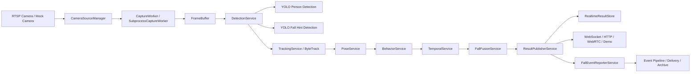

# 系统项目详细介绍

更新时间：2026-07-20

## 1. 项目定位

本项目是一个面向养老看护场景的实时视觉监护系统，核心目标是：

- 接入摄像头或 mock 视频源，持续采集画面
- 对画面进行人体检测、目标跟踪、姿态分析、行为分析和时序分析
- 对跌倒相关事件进行多证据融合判断
- 通过 WebSocket、HTTP、WebRTC 和事件接口把结果展示给前端或主系统
- 生成事件快照、关键帧和审计数据，便于复核和联调

系统当前的主线不是“单一模型”，而是“采集 -> 分析 -> 融合 -> 事件 -> 展示/上报”的整条实时链路。

## 2. 系统组成

项目主要由以下几个部分组成：

- `Vision Service`：主视觉服务，负责摄像头接入、AI 推理、结果融合和对外接口
- `identity_service`：独立身份识别服务，提供身份注册、查询和删除
- `robot_assist_service`：独立机器人协助服务，默认关闭，只在显式启用时提供 mock 任务接口
- `frontend_demo`：浏览器演示页面，用来查看视频、状态和分析结果
- `docs`：项目说明、验收、运行手册和接口契约
- `scripts`：训练、评估、回放、验收和调试脚本

## 3. 总体架构



系统设计的关键点是“只保留最新结果”，而不是维护无界长队列。这样更适合实时视觉场景，也能避免滞后和堆积。

## 4. 主链路说明

### 4.1 摄像头接入

系统支持两类输入：

- 真实 RTSP 摄像头
- mock 摄像头，用于开发、演示和回归验证

摄像头接入后会经过采集 worker，把最新帧写入 `FrameBuffer`，供后续检测与前端展示使用。

### 4.2 人体检测

人体检测使用 YOLO 系列模型，输出 person 框和置信度。它是整条链路的起点，后续跟踪、姿态、时序和融合都依赖它提供的目标。

### 4.3 跟踪

跟踪使用 ByteTrack 思路，为同一个人分配稳定的 `track_id`，减少检测抖动带来的 ID 跳变。

### 4.4 姿态分析

姿态模块支持多个 provider：

- `yolo`
- `yolo11_legacy`
- `rtmpose`
- `rtmpose_onnx`
- `mmpose`
- `disabled_placeholder`

它的作用是补充人体姿态特征，例如站立、弯腰、躺卧、低姿态等。

### 4.5 行为分析

行为模块负责输出较轻量的行为判断，例如：

- standing
- walking
- sitting
- bending
- lying

它更多是辅助证据，而不是最终裁决。

### 4.6 时序分析

时序模块会把连续帧的特征组织成窗口，输入 LSTM / ONNX / mock 等模型，判断跌倒过程中的连续变化，而不是只看单帧。

### 4.7 跌倒融合

融合模块会结合：

- 人体检测结果
- 跟踪结果
- 姿态结果
- 行为结果
- 跌倒提示检测
- 时序模型结果

最终输出统一的风险和跌倒判断。

### 4.8 结果发布

结果发布模块会把融合后的结果写入实时结果仓库，并同步到：

- WebSocket
- HTTP 集成接口
- Demo 页面
- 事件和告警链路

## 5. 对外能力

### 5.1 Vision Service

主服务由 `app/main.py` 启动，提供以下能力：

- 健康检查
- 当前状态查询
- 摄像头启动、停止和探测
- WebRTC 视频推送
- WebSocket 实时结果流
- 身份注册和身份管理
- 事件查询
- 主系统集成接口
- 告警模拟接口
- 设备发现接口

常见接口包括：

- `GET /healthz`
- `GET /status`
- `POST /stream/start`
- `POST /stream/stop`
- `GET /stream/latest-frame.jpg`
- `POST /webrtc/offer`
- `WS /ws/results`
- `POST /identity/enroll`
- `GET /integration/connection-status`
- `GET /integration/results/{camera_id}/latest`
- `GET /integration/fall-alerts/{camera_id}/poll`

### 5.2 Identity Service

独立身份服务提供：

- `POST /enroll`
- `POST /match`
- `GET /list`
- `DELETE /{person_id}`

它用于身份侧边管理，不直接参与实时主链路。

### 5.3 Robot Assist Service

机器人协助服务当前默认隐藏关闭。只有显式启用时才会挂载任务 API。

启用后可提供：

- 健康检查
- 机器人状态查询
- 任务创建
- 任务查询
- 任务事件查询
- 审批
- 取消

当前默认策略是：

- 不自动启用
- 不自动派遣
- 不开放 Go2 控制
- 不把它作为主链路的一部分

## 6. 前端演示页

`frontend_demo` 是一个可直接打开的浏览器演示界面，主要用于：

- 查看实时画面
- 查看摄像头状态
- 查看检测、跟踪、姿态、时序和融合结果
- 查看事件摘要和告警状态
- 做联调和演示

它的目标不是“展示所有实验能力”，而是让当前可信功能一眼可见。

## 7. 事件与告警

系统支持事件化输出，围绕跌倒事件生成：

- `incident_id`
- 快照
- 关键帧
- 时间线
- 事件语义
- 投递记录

事件链路包括：

- 事件状态查询
- outbox
- delivery 状态
- 关键帧按 offset 查询
- 事件详情查询

这部分适合做审计、复核和主系统联动。

## 8. 配置原则

系统通过 `.env` 控制运行模式。当前更推荐的稳定边界是：

- 视觉主链路开启
- 事件投递默认关闭
- 多模态 advisory 默认关闭
- Robot Assist 默认关闭
- Go2 控制默认关闭

典型安全开关包括：

- `ENABLE_TRACKING=true`
- `ENABLE_POSE=true` 或按需关闭
- `ENABLE_TEMPORAL=true` 或按需关闭
- `MAIN_SYSTEM_ALERT_ENABLED=false`
- `EVENT_DELIVERY_ENABLED=false`
- `EVENT_VLM_ENABLED=false`
- `ROBOT_ASSIST_SERVICE_ENABLED=false`
- `ROBOT_ASSIST_ENABLED=false`
- `GO2_CONTROL_ENABLED=false`

## 9. 运行方式

主服务运行入口：

```powershell
python -m uvicorn app.main:app --host 0.0.0.0 --port 8000
```

演示页通常通过：

```text
http://127.0.0.1:8000/demo
```

独立身份服务和机器人协助服务可单独启动，适合拆分调试和边界验证。

## 10. 当前系统特征

这个系统当前的特点不是“单点功能”，而是“链路完整”：

- 能接摄像头
- 能稳定处理实时帧
- 能把多路视觉证据合成统一结果
- 能把结果送到前端和主系统接口
- 能生成事件和审计材料
- 能对实验性能力做默认关闭和边界隔离

## 11. 建议的对外描述

如果要用一句话介绍这个项目，可以写成：

> 这是一个面向养老看护场景的实时视觉监护系统，支持摄像头接入、人体检测、目标跟踪、姿态与时序分析、跌倒融合判断、事件输出和前端展示，并预留身份识别、事件投递和机器人协作等扩展能力。

## 12. 适合下一步补充的内容

如果后续要继续完善这份文档，建议补充：

- 部署拓扑图
- 配置项表格
- 接口参数示例
- 状态机说明
- 事件数据结构说明
- 常见故障排查清单

